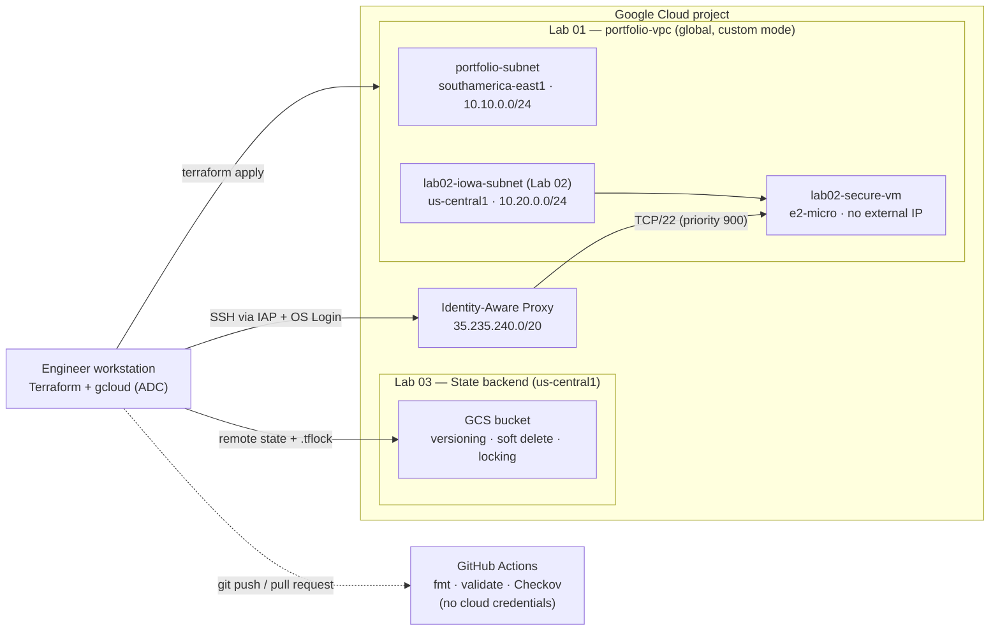

# Hi, I'm Matheus Silva

**IT Infrastructure & Telecommunications Professional | Aspiring Google Cloud Engineer**

[English](README.md) | [Português (Brasil)](README.pt-BR.md)

[](https://github.com/matheuslab-bit/matheuslab-bit/actions/workflows/terraform-ci.yml)


I work with IT and telecommunications infrastructure, including SIP/VoIP troubleshooting and technical support. My background also includes hands-on experience with Active Directory, VMware, and Hyper-V. I am now building practical Google Cloud engineering skills through reproducible labs, security-first design, Terraform, and documented testing.

My goal is to move into a **remote cloud engineering or cloud operations role**. This GitHub profile is a learning portfolio, not a claim of production cloud experience.

## Featured Google Cloud labs

| Lab | What it demonstrates | Status |
| --- | --- | --- |
| [01 — VPC Networking](projects/01-vpc-network/README.md) | Custom-mode VPC (`portfolio-vpc`) and regional subnet (`10.10.0.0/24`) in São Paulo (`southamerica-east1`); remote state in GCS with state locking | **Deployed; state migrated to GCS** (Nov 20, 2026) |
| [02 — Secure Compute Engine](projects/02-secure-compute-engine/README.md) | Private Debian 12 `e2-micro` VM in Iowa (`us-central1-a`), IAP-only SSH, OS Login, Shielded VM, priority `900`/`901` firewall ordering, dedicated service account | **Deployed; IAP/OS Login SSH tested** (Nov 18, 2026); **state migrated to GCS** (Nov 20, 2026) |
| [03 — Terraform Remote State (GCS)](projects/03-terraform-backend/README.md) | Hardened Cloud Storage bucket with object versioning, 7-day Soft Delete, 90-day noncurrent lifecycle rule, uniform access, public access prevention, and deletion guardrails | **Deployed; hosting Lab 01 and Lab 02 states** (Nov 20, 2026) |

## Portfolio architecture



- **Lab 01** owns the global VPC and the São Paulo subnet.
- **Lab 02** reads the VPC through a data source and owns only its Iowa subnet, firewall rules, service account, and VM.
- **Lab 03** is the bootstrap layer: its own state stays local, and it stores the remote state of Labs 01 and 02 in isolated prefixes (`labs/01-vpc-network`, `labs/02-secure-compute-engine`).
- Iowa (`us-central1`) was selected for potential Free Tier eligibility. **Eligibility is not a guarantee of zero charges.**

## Engineering practices

| Practice | How it is applied |
| --- | --- |
| Infrastructure as Code | Every resource is declared in Terraform with pinned provider versions (`7.46.2`) and committed lock files. |
| Input validation | Project IDs, zones, CIDR ranges, bucket names, and retention days are validated before any API call. |
| Remote state | Versioned GCS backend with native locking, isolated prefixes per lab, and a documented recovery procedure. |
| Continuous integration | One [GitHub Actions workflow](.github/workflows/terraform-ci.yml) runs `terraform fmt`, `init -backend=false`, and `validate` for each lab, plus a Checkov security scan. |
| Security as code | Checkov findings are either fixed or recorded as accepted risks with inline `#checkov:skip` justifications next to the resource. |
| Least privilege | No public IPs, IAP-only SSH, OS Login, Shielded VM, dedicated service accounts without keys or project roles. |
| Honest documentation | Each lab separates **planned**, **validated**, and **deployed/tested** work, with dates and PR links as evidence. |

## Repository structure

```text
.
├── .github/workflows/terraform-ci.yml   # Validation matrix + Checkov security scan
├── projects/
│   ├── 01-vpc-network/                  # Lab 01 — custom VPC and subnet
│   ├── 02-secure-compute-engine/        # Lab 02 — private VM with IAP and OS Login
│   ├── 03-terraform-backend/            # Lab 03 — GCS remote state bucket (bootstrap)
│   └── archive/                         # Superseded first prototype (reference only)
├── ROADMAP.md / ROADMAP.pt-BR.md        # Learning roadmap and progress log
└── README.md / README.pt-BR.md          # This profile page
```

*Historical reference:* the earlier monolithic prototype is preserved in [`projects/archive/gcp-secure-infrastructure/`](projects/archive/gcp-secure-infrastructure/README.md) and was superseded by the modular labs above.

[Browse the project index](projects/README.md) | [Follow the learning roadmap](ROADMAP.md)

## Technical focus

- **Demonstrated in published labs:** Google Cloud VPC design, Compute Engine (private Debian 12 VM, Shielded VM), Cloud Storage (Terraform remote state backend, object versioning, Soft Delete, lifecycle rules, state locking), IAM service account isolation, IAP TCP forwarding, OS Login, VPC firewall ordering, Terraform, Git, GitHub Actions, and Checkov
- **Systems and networking foundation:** Linux, Windows Server/Active Directory, VMware, Hyper-V, TCP/IP, DNS, firewalls, and SIP/VoIP infrastructure troubleshooting
- **Next labs and study:** Workload Identity Federation (keyless CI/CD), Cloud Monitoring and Cloud Logging, Cloud NAT, Cloud Run, Artifact Registry, Cloud SQL, Secret Manager, containers, and the Google Cloud Associate Cloud Engineer (ACE) certification

## How I document my work

1. Define the goal, architecture, and scope of each lab.
2. Version the configuration and validate it with automated checks.
3. Record security decisions, permissions, and cost considerations.
4. Separate **planned**, **validated**, and **deployed/tested** work.
5. Never publish credentials, Terraform state, or sensitive infrastructure details.

## Contact

- **Email:** [matheus.silva.gcp@gmail.com](mailto:matheus.silva.gcp@gmail.com)
- **GitHub:** [github.com/matheuslab-bit](https://github.com/matheuslab-bit)

---

*Portfolio in progress. Infrastructure exercises are for learning, not production hosting.*
