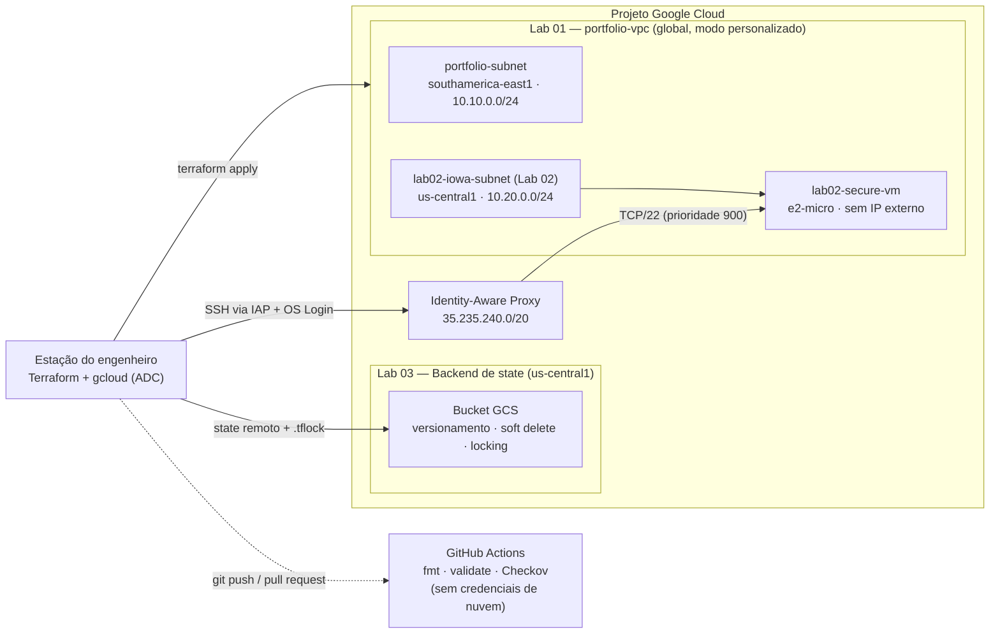

# Olá, sou Matheus Silva

**Profissional de Infraestrutura de TI e Telecomunicações | Em formação para Google Cloud Engineer**

[English](README.md) | [Português (Brasil)](README.pt-BR.md)

[](https://github.com/matheuslab-bit/matheuslab-bit/actions/workflows/terraform-ci.yml)


Atuo com infraestrutura de TI e telecomunicações, incluindo suporte técnico e análise de falhas SIP/VoIP. Também possuo experiência prática com Active Directory, VMware e Hyper-V. Atualmente, desenvolvo competências em Google Cloud por meio de laboratórios reproduzíveis, práticas de segurança, Terraform e testes documentados.

Meu objetivo é conquistar uma oportunidade **remota em engenharia ou operações de nuvem**. Este GitHub é um portfólio de aprendizado, não uma declaração de experiência profissional em nuvem de produção.

## Laboratórios Google Cloud em destaque

| Laboratório | O que demonstra | Status |
| --- | --- | --- |
| [01 — Redes VPC](projects/01-vpc-network/README.pt-BR.md) | VPC em modo personalizado (`portfolio-vpc`) e sub-rede regional (`10.10.0.0/24`) em São Paulo (`southamerica-east1`); state remoto no GCS com state locking | **Implantado; state migrado para o GCS** (20/11/2026) |
| [02 — Compute Engine seguro](projects/02-secure-compute-engine/README.pt-BR.md) | VM Debian 12 `e2-micro` privada em Iowa (`us-central1-a`), SSH apenas por IAP, OS Login, Shielded VM, ordenação de firewall `900`/`901` e conta de serviço dedicada | **Implantado; SSH via IAP/OS Login testado** (18/11/2026); **state migrado para o GCS** (20/11/2026) |
| [03 — Terraform Remote State (GCS)](projects/03-terraform-backend/README.pt-BR.md) | Bucket Cloud Storage endurecido com versionamento de objetos, Soft Delete de 7 dias, ciclo de vida de 90 dias para versões antigas, acesso uniforme, prevenção de acesso público e proteções contra exclusão | **Implantado; armazenando os states dos Labs 01 e 02** (20/11/2026) |

## Arquitetura do portfólio



- O **Lab 01** é dono da VPC global e da sub-rede de São Paulo.
- O **Lab 02** consulta a VPC por data source e gerencia apenas sua sub-rede em Iowa, as regras de firewall, a conta de serviço e a VM.
- O **Lab 03** é a camada de bootstrap: seu próprio state fica local, e ele armazena o state remoto dos Labs 01 e 02 em prefixos isolados (`labs/01-vpc-network`, `labs/02-secure-compute-engine`).
- A região de Iowa (`us-central1`) foi escolhida por possível elegibilidade ao Free Tier. **Elegibilidade não garante custo zero.**

## Práticas de engenharia

| Prática | Como é aplicada |
| --- | --- |
| Infraestrutura como Código | Todos os recursos são declarados em Terraform, com versão do provedor fixada (`7.46.2`) e lock files versionados. |
| Validação de entradas | IDs de projeto, zonas, faixas CIDR, nomes de bucket e dias de retenção são validados antes de qualquer chamada à API. |
| State remoto | Backend GCS versionado, com locking nativo, prefixos isolados por laboratório e procedimento de recuperação documentado. |
| Integração contínua | Um único [workflow do GitHub Actions](.github/workflows/terraform-ci.yml) executa `terraform fmt`, `init -backend=false` e `validate` em cada laboratório, além de um scan de segurança com Checkov. |
| Segurança como código | Achados do Checkov são corrigidos ou registrados como riscos aceitos, com justificativas `#checkov:skip` ao lado do recurso. |
| Menor privilégio | Sem IP público, SSH apenas por IAP, OS Login, Shielded VM e contas de serviço dedicadas sem chaves nem papéis no projeto. |
| Documentação honesta | Cada laboratório separa o que foi **planejado**, **validado** e **implantado/testado**, com datas e links de PR como evidência. |

## Estrutura do repositório

```text
.
├── .github/workflows/terraform-ci.yml   # Matriz de validação + scan de segurança Checkov
├── projects/
│   ├── 01-vpc-network/                  # Lab 01 — VPC personalizada e sub-rede
│   ├── 02-secure-compute-engine/        # Lab 02 — VM privada com IAP e OS Login
│   ├── 03-terraform-backend/            # Lab 03 — bucket GCS de state remoto (bootstrap)
│   └── archive/                         # Primeiro protótipo, substituído (apenas referência)
├── ROADMAP.md / ROADMAP.pt-BR.md        # Plano de estudos e registro de progresso
└── README.md / README.pt-BR.md          # Esta página de perfil
```

*Referência histórica:* o protótipo monolítico inicial permanece preservado em [`projects/archive/gcp-secure-infrastructure/`](projects/archive/gcp-secure-infrastructure/README.md) e foi sucedido pelos laboratórios modulares acima.

[Ver índice dos projetos](projects/README.pt-BR.md) | [Acompanhar plano de estudos](ROADMAP.pt-BR.md)

## Foco técnico

- **Demonstrado nos laboratórios publicados:** redes VPC no Google Cloud, Compute Engine (VM privada Debian 12, Shielded VM), Cloud Storage (backend de state remoto do Terraform, versionamento de objetos, Soft Delete, regras de ciclo de vida, state locking), isolamento de contas de serviço IAM, encaminhamento TCP via IAP, OS Login, ordenação de regras de firewall VPC, Terraform, Git, GitHub Actions e Checkov
- **Base em sistemas e redes:** Linux, Windows Server/Active Directory, VMware, Hyper-V, TCP/IP, DNS, firewalls e diagnóstico de infraestrutura SIP/VoIP
- **Próximos laboratórios e estudos:** Workload Identity Federation (CI/CD sem chaves), Cloud Monitoring e Cloud Logging, Cloud NAT, Cloud Run, Artifact Registry, Cloud SQL, Secret Manager, contêineres e certificação Google Cloud Associate Cloud Engineer (ACE)

## Como documento meu trabalho

1. Defino objetivo, arquitetura e escopo de cada laboratório.
2. Versiono a configuração e verifico com validações automatizadas.
3. Registro escolhas de segurança, permissões e cuidados com custos.
4. Distingo claramente o que foi **planejado**, **validado** e **implantado/testado**.
5. Não publico credenciais, estados do Terraform ou informações sensíveis de infraestrutura.

## Contato

- **E-mail:** [matheus.silva.gcp@gmail.com](mailto:matheus.silva.gcp@gmail.com)
- **GitHub:** [github.com/matheuslab-bit](https://github.com/matheuslab-bit)

---

*Portfólio em desenvolvimento. Os exercícios de infraestrutura são para aprendizado, não hospedagem de produção.*
