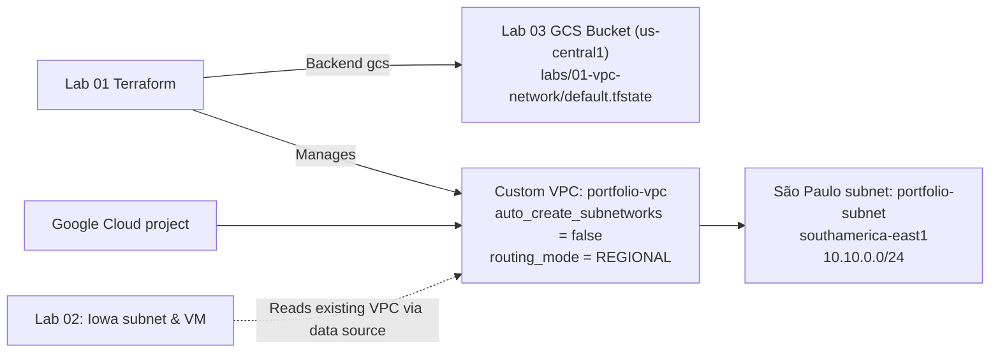

# Lab 01 — VPC Networking on Google Cloud

[English](README.md) | [Português (Brasil)](README.pt-BR.md)

**Status: deployed in São Paulo (`southamerica-east1`) and remote Terraform state migrated to Google Cloud Storage (`labs/01-vpc-network`) on November 20, 2026.**

Terraform configuration for a custom-mode Virtual Private Cloud (VPC) network and a regional subnet on Google Cloud. This lab is independent of the archived prototype [`../archive/gcp-secure-infrastructure/`](../archive/gcp-secure-infrastructure/README.md) and stores its remote state in the hardened GCS bucket provisioned by [Lab 03](../03-terraform-backend/README.md).

## Objective

Design, deploy, and govern a foundational Google Cloud network using Terraform, disabling automatic subnet creation to enforce explicit CIDR planning, regional routing, and isolated remote state management with native GCS state locking.

## Architecture

- **Custom-mode VPC:** `portfolio-vpc` (`auto_create_subnetworks = false`, `routing_mode = "REGIONAL"`).
- **Regional subnet:** `portfolio-subnet` with IPv4 CIDR `10.10.0.0/24` in São Paulo (`southamerica-east1`).
- **Remote State Backend (`backend.tf`):** GCS bucket `gcp-portfolio-tfstate-usc1-7f4e9a2c` (`us-central1`) under prefix `labs/01-vpc-network`, protected by object versioning, 7-day Soft Delete, and `.tflock` distributed locking.



### Inputs (`variables.tf`) and Outputs (`outputs.tf`)

| Type | Name | Description | Default / Value |
| --- | --- | --- | --- |
| Variable | `project_id` | Target Google Cloud project ID | *(required)* |
| Variable | `region` | Region where subnet resources are created | `southamerica-east1` |
| Variable | `network_name` | Name of the custom VPC network | `portfolio-vpc` |
| Variable | `subnet_name` | Name of the regional subnet | `portfolio-subnet` |
| Variable | `subnet_cidr` | IPv4 CIDR range for the subnet | `10.10.0.0/24` |
| Output | `vpc_name` | Name of the VPC network | `google_compute_network.portfolio_vpc.name` |
| Output | `vpc_id` | Identifier of the VPC network | `google_compute_network.portfolio_vpc.id` |
| Output | `subnet_name` | Name of the subnet | `google_compute_subnetwork.portfolio_subnet.name` |
| Output | `subnet_cidr` | IPv4 CIDR range of the subnet | `google_compute_subnetwork.portfolio_subnet.ip_cidr_range` |
| Output | `subnet_region` | Region of the subnet | `google_compute_subnetwork.portfolio_subnet.region` |

## Deployment and Remote State Status

- **Cloud deployment:** `portfolio-vpc` and `portfolio-subnet` (`10.10.0.0/24` in `southamerica-east1`) are deployed and active in Google Cloud. The global `portfolio-vpc` network is also referenced via data source by [Lab 02](../02-secure-compute-engine/README.md) for its Iowa subnet.
- **Backend configuration and state migration (November 20, 2026):** `backend.tf` was added and versioned in [PR #10](https://github.com/matheuslab-bit/matheuslab-bit/pull/10), while the effective state migration from local disk to `gs://gcp-portfolio-tfstate-usc1-7f4e9a2c/labs/01-vpc-network/default.tfstate` was executed locally with `terraform init -migrate-state` on November 20, 2026. Post-migration verification with `terraform state list`, `terraform plan` (`No changes. Your infrastructure matches the configuration.`), and `gcloud compute` confirmed zero drift and active object versioning.

## Validation and GitHub Actions Evidence

Local formatting (`terraform fmt -check -recursive`), `terraform validate`, and `terraform plan` (with GCS state locking) passed using Terraform `1.17.2` and Google provider `7.46.2`.

In GitHub Actions ([`01-vpc-network-check.yml`](../../.github/workflows/01-vpc-network-check.yml)), both `push` and `pull_request` runs completed successfully on `ubuntu-latest` using Terraform `1.9.8`:

```powershell
terraform fmt -check -recursive
terraform init -backend=false -lockfile=readonly
terraform validate
```

CI uses `-backend=false` to perform static syntax and schema validation without requiring cloud credentials.

## Prerequisites

- Terraform `1.9.8` or compatible `1.x` release (CI uses `1.9.8`).
- A Google Cloud project with billing and the Compute Engine API enabled.
- Access to the remote state bucket (`roles/storage.objectAdmin` on the bucket) and permissions to manage VPC networks when running `plan` or `apply` against the live backend.
- Google Cloud CLI (`gcloud`) for local Application Default Credentials authentication.

The Google provider constraint is `~> 7.0`, with version `7.46.2` pinned in `.terraform.lock.hcl`.

## Validate Without Cloud Credentials

Run from `projects/01-vpc-network/` in a clean environment or CI runner:

```powershell
terraform fmt -check -recursive
terraform init -backend=false -lockfile=readonly
terraform validate
```

## Working with the Live GCS Backend

When authenticated to the project and state bucket:

```powershell
gcloud auth application-default login
terraform init -lockfile=readonly
terraform plan
```

The `project_id` variable is supplied locally via an untracked `terraform.tfvars` file (or `-var="project_id=YOUR_PROJECT_ID"`). Never store credentials in Terraform files.

## Cost and Cleanup Precautions

VPC networks and regional subnets without external IPs, Cloud NAT, or VPNs/Interconnects do not incur fixed hourly charges, though network egress and associated workloads can incur charges.

Because [Lab 02](../02-secure-compute-engine/README.md) depends on `portfolio-vpc`, **do not run `terraform destroy` on Lab 01** while Lab 02 resources exist. Keep `.terraform/`, local state backups, saved plans, credentials, and `*.tfvars` out of Git.

## Progress Checklist

- [x] Terraform configuration imported and documented (`main.tf`, `variables.tf`, `outputs.tf`, `backend.tf`)
- [x] Local formatting (`terraform fmt -check`) and `terraform validate` passed
- [x] GitHub Actions CI validation (`push` and `pull_request`) passed
- [x] Cloud deployment in São Paulo (`portfolio-vpc` and `portfolio-subnet`, `10.10.0.0/24`) verified via `gcloud compute` and `terraform plan` (`No changes`)
- [x] GCS backend configuration versioned ([PR #10](https://github.com/matheuslab-bit/matheuslab-bit/pull/10)) and state migrated locally via `terraform init -migrate-state` (`labs/01-vpc-network`) with state locking and object versioning verified
