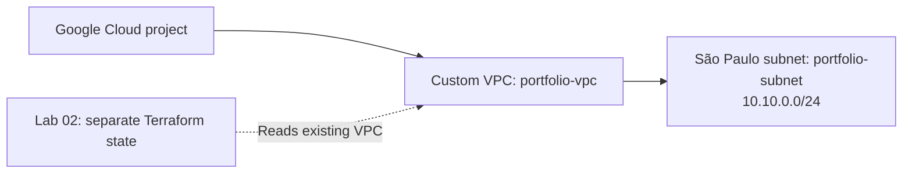

# Lab 01 — VPC Networking on Google Cloud

[English](README.md) | [Português (Brasil)](README.pt-BR.md)

Terraform configuration for a custom VPC network and a regional subnet. This lab is independent of `../gcp-secure-infrastructure/` and must be run from its own directory with a separate Terraform state.

## Architecture

- Custom-mode VPC `portfolio-vpc`, without automatically created subnets and with regional routing.
- Regional subnet `portfolio-subnet`, CIDR `10.10.0.0/24`.
- Default region: São Paulo (`southamerica-east1`).
- Terraform outputs for VPC name/ID and subnet name, CIDR and region.



## Provenance and implementation status

The five original files were imported from the local commit `3bbe522e141bf5fe9cb505a9a606f0b42b6fb98c` in the `GoogleCloudPortfolio` project. Its root `.gitignore` was copied into this directory. The original history remains in that local repository.

**This integration did not deploy cloud resources.** An existing state in the original project is not evidence of currently active resources. This lab's CI validates configuration; it does not run `plan`, `apply`, or `destroy`.

The existing VPC is referenced by Lab 02. The infrastructure ownership and state lifecycle must be verified separately before running a new apply.

## Validation evidence

Local `terraform fmt -check -recursive`, provider initialization without a backend and `terraform validate` passed using Terraform 1.17.2 and Google provider 7.46.2. Both GitHub Actions runs (`push` and `pull_request`) passed using Terraform 1.9.8 with:

```powershell
terraform fmt -check -recursive
terraform init -backend=false -lockfile=readonly
terraform validate
```

No `plan`, `apply` or `destroy` was executed as part of this integration.

## Prerequisites

- Terraform 1.9.8 (the GitHub Actions version).
- Google Cloud project with billing and Compute Engine API enabled.
- Authenticated identity with permissions to manage project networks.
- Google Cloud CLI for local authentication, if needed.

The Google provider version constraint is `~> 7.0`; version 7.46.2 is recorded in `.terraform.lock.hcl`. The earlier `gcp-secure-infrastructure` reference uses its own Google provider 6.x. **Do not merge Terraform states or files across labs.**

## Validate without deploying

From this directory:

```powershell
terraform fmt -check -recursive
terraform init -backend=false -lockfile=readonly
terraform validate
```

Provider initialization downloads dependencies but does not create cloud resources.

## Optional manual deployment

Review the target Google Cloud project and resource names to avoid conflicting with existing resources. Do not `apply` a configuration to take ownership of a VPC managed by a different Terraform state.

```powershell
gcloud auth application-default login
terraform init -lockfile=readonly
terraform plan -var="project_id=YOUR_PROJECT_ID"
```

Only after inspecting the plan may you run `terraform apply -var="project_id=YOUR_PROJECT_ID"` and confirm interactively. Region, names and CIDR values are configurable through variables. Do not store credentials in Terraform files.

## Cleanup and cost precautions

Only destroy resources if this Terraform state created them and you have reviewed ownership and dependencies. Before `terraform destroy -var="project_id=YOUR_PROJECT_ID"`, verify the VPC is not needed by another lab, including Lab 02.

Keep `.terraform/`, state files, plans, credentials and `*.tfvars` out of Git. Commit the provider lockfile. Do not copy state from the original project into this directory.

## Checklist

- [x] Terraform configuration imported and documented
- [x] Local formatting and validation passed
- [x] GitHub Actions validation passed
- [ ] Independent cloud deployment evidence published for this lab

**Status: configuration validated; an independent Lab 01 deployment is not documented here.**
