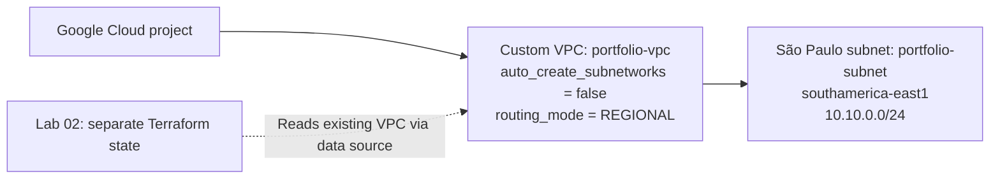

# Lab 01 — VPC Networking on Google Cloud

[English](README.md) | [Português (Brasil)](README.pt-BR.md)

Terraform configuration for a custom-mode Virtual Private Cloud (VPC) network and a regional subnet on Google Cloud. This lab is independent of the archived prototype [`../archive/gcp-secure-infrastructure/`](../archive/gcp-secure-infrastructure/README.md) and must be executed from its own directory with an isolated Terraform state.

## Objective

Design and validate a foundational Google Cloud network using Terraform, disabling automatic subnet creation to enforce explicit CIDR planning, regional routing, and clean Infrastructure as Code state separation.

## Architecture

- **Custom-mode VPC:** `portfolio-vpc` (`auto_create_subnetworks = false`, `routing_mode = "REGIONAL"`).
- **Regional subnet:** `portfolio-subnet` with IPv4 CIDR `10.10.0.0/24`.
- **Default region:** São Paulo (`southamerica-east1`).



### Inputs (`variables.tf`) and Outputs (`outputs.tf`)

| Type | Name | Description | Default / Value |
| --- | --- | --- | --- |
| Variable | `project_id` | Target Google Cloud project ID | *(required)* |
| Variable | `region` | Region where subnet resources are created | `southamerica-east1` |
| Variable | `network_name` | Name of the custom VPC network | `portfolio-vpc` |
| Variable | `subnet_name` | Name of the regional subnet | `portfolio-subnet` |
| Variable | `subnet_cidr` | IPv4 CIDR range for the subnet | `10.10.0.0/24` |
| Output | `vpc_name` | Name of the VPC network | `google_compute_network.portfolio_vpc.name` |
| Output | `vpc_id` | Identifier of the VPC network | `google_compute_network.portfolio_vpc.id` |
| Output | `subnet_name` | Name of the subnet | `google_compute_subnetwork.portfolio_subnet.name` |
| Output | `subnet_cidr` | IPv4 CIDR range of the subnet | `google_compute_subnetwork.portfolio_subnet.ip_cidr_range` |
| Output | `subnet_region` | Region of the subnet | `google_compute_subnetwork.portfolio_subnet.region` |

## Provenance and implementation status

The five original Terraform files were imported from local commit `3bbe522e141bf5fe9cb505a9a606f0b42b6fb98c` in the `GoogleCloudPortfolio` workspace, along with its `.gitignore`.

**This integration did not deploy cloud resources.** The presence of a local state in the original workspace is not presented here as standalone cloud deployment evidence. This lab's CI workflow validates formatting and configuration syntax; it does not execute `plan`, `apply`, or `destroy`.

The `portfolio-vpc` network is referenced via data source by [Lab 02](../02-secure-compute-engine/README.md). Infrastructure ownership and state lifecycle must always be verified before running any new apply.

## Validation and GitHub Actions evidence

Local formatting (`terraform fmt -check -recursive`), backend-disabled provider initialization with a read-only lockfile, and `terraform validate` passed using Terraform 1.17.2 and Google provider `7.46.2`.

In GitHub Actions ([`01-vpc-network-check.yml`](../../.github/workflows/01-vpc-network-check.yml)), both `push` and `pull_request` runs completed successfully on `ubuntu-latest` using Terraform `1.9.8`:

```powershell
terraform fmt -check -recursive
terraform init -backend=false -lockfile=readonly
terraform validate
```

No `plan`, `apply`, or `destroy` was executed during CI validation.

## Prerequisites

- Terraform `1.9.8` or compatible `1.x` release (CI uses `1.9.8`).
- A Google Cloud project with billing and the Compute Engine API enabled.
- An authenticated identity with permissions to manage VPC networks in the target project.
- Google Cloud CLI (`gcloud`) for local Application Default Credentials authentication, if running `plan` or `apply` locally.

The Google provider constraint is `~> 7.0`, with version `7.46.2` pinned in `.terraform.lock.hcl`. The archived prototype [`../archive/gcp-secure-infrastructure/`](../archive/gcp-secure-infrastructure/README.md) uses a separate Google provider `6.x` definition — **never merge files or Terraform states across labs**.

## Validate without deploying

Run from `projects/01-vpc-network/`:

```powershell
terraform fmt -check -recursive
terraform init -backend=false -lockfile=readonly
terraform validate
```

Provider initialization downloads the provider binary to verify types and schemas without contacting a Google Cloud project or creating cloud resources.

## Optional manual deployment

Review the target Google Cloud project and resource names to avoid conflicts with existing networks. Never run `apply` to take over a VPC already managed by another Terraform state.

```powershell
gcloud auth application-default login
terraform init -lockfile=readonly
terraform plan -var="project_id=YOUR_PROJECT_ID"
```

After inspecting the plan, a manual deployment can be executed with `terraform apply -var="project_id=YOUR_PROJECT_ID"` using interactive confirmation. Region, resource names, and CIDR ranges can be customized via variables. Never store credentials in Terraform files.

## Cost and cleanup precautions

Only run `terraform destroy -var="project_id=YOUR_PROJECT_ID"` if this lab's state created the resources and you have verified that no other workload or lab depends on the VPC (including [Lab 02](../02-secure-compute-engine/README.md)). Evaluate project billing and associated networking services before deploying.

Keep `.terraform/`, state files, saved plans, credentials, and `*.tfvars` out of Git. Keep `.terraform.lock.hcl` versioned.

## Progress checklist

- [x] Terraform configuration imported and documented
- [x] Input variables and outputs structured
- [x] Local formatting and `terraform validate` passed
- [x] GitHub Actions CI validation (`push` and `pull_request`) passed
- [ ] Independent cloud deployment evidence published specifically for this lab

**Status: Terraform configuration and CI validated; independent Lab 01 deployment evidence is not documented here.**
