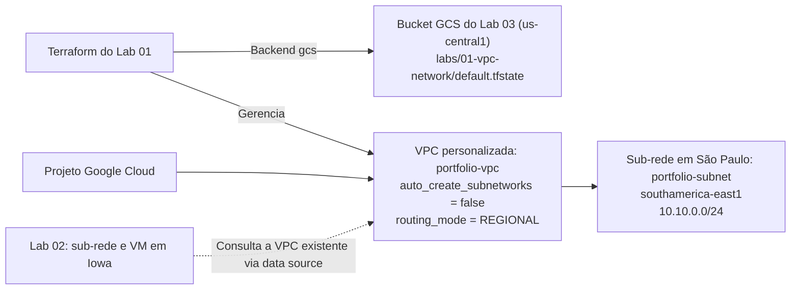

# Laboratório 01 — Rede VPC no Google Cloud

[English](README.md) | [Português (Brasil)](README.pt-BR.md)

**Status: implantado em São Paulo (`southamerica-east1`) e estado Terraform migrado para o Google Cloud Storage (`labs/01-vpc-network`) em 20 de novembro de 2026.**

Configuração Terraform para uma rede Virtual Private Cloud (VPC) em modo personalizado e uma sub-rede regional no Google Cloud. Este laboratório é independente do protótipo arquivado [`../archive/gcp-secure-infrastructure/`](../archive/gcp-secure-infrastructure/README.md) e armazena seu estado remoto no bucket GCS endurecido provisionado pelo [Laboratório 03](../03-terraform-backend/README.pt-BR.md).

## Objetivo

Projetar, implantar e governar uma rede base no Google Cloud utilizando Terraform, desativando a criação automática de sub-redes para garantir planejamento explícito de faixas CIDR, roteamento regional e gerenciamento isolado de estado remoto com bloqueio nativo (*state locking*) no GCS.

## Arquitetura

- **VPC em modo personalizado:** `portfolio-vpc` (`auto_create_subnetworks = false`, `routing_mode = "REGIONAL"`).
- **Sub-rede regional:** `portfolio-subnet` com faixa IPv4 `10.10.0.0/24` em São Paulo (`southamerica-east1`).
- **Backend de Estado Remoto (`backend.tf`):** bucket GCS `gcp-portfolio-tfstate-usc1-7f4e9a2c` (`us-central1`) sob o prefixo `labs/01-vpc-network`, protegido por versionamento de objetos, Soft Delete de 7 dias e bloqueio distribuído `.tflock`.



### Variáveis (`variables.tf`) e Outputs (`outputs.tf`)

| Tipo | Nome | Descrição | Padrão / Valor |
| --- | --- | --- | --- |
| Variável | `project_id` | ID do projeto de destino no Google Cloud | *(obrigatório)* |
| Variável | `region` | Região onde os recursos de sub-rede são criados | `southamerica-east1` |
| Variável | `network_name` | Nome da rede VPC personalizada | `portfolio-vpc` |
| Variável | `subnet_name` | Nome da sub-rede regional | `portfolio-subnet` |
| Variável | `subnet_cidr` | Faixa de endereços IPv4 (CIDR) da sub-rede | `10.10.0.0/24` |
| Output | `vpc_name` | Nome da rede VPC | `google_compute_network.portfolio_vpc.name` |
| Output | `vpc_id` | Identificador da rede VPC | `google_compute_network.portfolio_vpc.id` |
| Output | `subnet_name` | Nome da sub-rede | `google_compute_subnetwork.portfolio_subnet.name` |
| Output | `subnet_cidr` | Faixa IPv4 (CIDR) da sub-rede | `google_compute_subnetwork.portfolio_subnet.ip_cidr_range` |
| Output | `subnet_region` | Região da sub-rede | `google_compute_subnetwork.portfolio_subnet.region` |

## Status de Implantação e Estado Remoto

- **Implantação na nuvem:** `portfolio-vpc` e `portfolio-subnet` (`10.10.0.0/24` em `southamerica-east1`) estão implantadas e ativas no Google Cloud. A rede global `portfolio-vpc` também é consultada via data source pelo [Laboratório 02](../02-secure-compute-engine/README.pt-BR.md) para sua sub-rede em Iowa.
- **Configuração do backend e migração de estado (20 de novembro de 2026):** o arquivo `backend.tf` foi adicionado e versionado no [PR #10](https://github.com/matheuslab-bit/matheuslab-bit/pull/10), enquanto a migração efetiva do estado do disco local para `gs://gcp-portfolio-tfstate-usc1-7f4e9a2c/labs/01-vpc-network/default.tfstate` foi executada localmente com `terraform init -migrate-state` em 20/11/2026. As verificações pós-migração com `terraform state list`, `terraform plan` (`No changes. Your infrastructure matches the configuration.`) e `gcloud compute` confirmaram ausência de desvio (*drift*) e versionamento ativo no bucket.

## Validações Terraform e Evidências do GitHub Actions

A formatação local (`terraform fmt -check -recursive`), o `terraform validate` e o `terraform plan` (com state locking no GCS) passaram utilizando Terraform `1.17.2` e provedor Google `7.46.2`.

No GitHub Actions ([`01-vpc-network-check.yml`](../../.github/workflows/01-vpc-network-check.yml)), as execuções de `push` e `pull_request` foram concluídas com sucesso em `ubuntu-latest` utilizando Terraform `1.9.8`:

```powershell
terraform fmt -check -recursive
terraform init -backend=false -lockfile=readonly
terraform validate
```

O CI utiliza `-backend=false` para executar validação estática de sintaxe e esquema sem exigir credenciais da nuvem.

## Pré-requisitos

- Terraform `1.9.8` ou versão `1.x` compatível (o workflow utiliza `1.9.8`).
- Projeto Google Cloud com faturamento e Compute Engine API habilitados.
- Acesso ao bucket de estado remoto (`roles/storage.objectAdmin` no bucket) e permissões para gerenciar redes VPC ao executar `plan` ou `apply` conectado ao backend remoto.
- Google Cloud CLI (`gcloud`) para autenticação local via Application Default Credentials.

A restrição do provedor Google é `~> 7.0`, com a versão `7.46.2` fixada em `.terraform.lock.hcl`.

## Validação sem Credenciais de Nuvem

Execute a partir de `projects/01-vpc-network/` em um ambiente limpo ou runner de CI:

```powershell
terraform fmt -check -recursive
terraform init -backend=false -lockfile=readonly
terraform validate
```

## Operação com o Backend Remoto GCS

Quando autenticado no projeto e no bucket de estado:

```powershell
gcloud auth application-default login
terraform init -lockfile=readonly
terraform plan
```

A variável `project_id` é fornecida localmente por meio de um arquivo `terraform.tfvars` não versionado (ou `-var="project_id=YOUR_PROJECT_ID"`). Não armazene credenciais em arquivos Terraform.

## Cuidados com Custos e Destruição

Redes VPC e sub-redes regionais sem IPs externos, Cloud NAT ou VPNs/Interconnects não possuem custo fixo por hora, embora tráfego de saída e cargas de trabalho associadas possam gerar cobranças.

Como o [Laboratório 02](../02-secure-compute-engine/README.pt-BR.md) depende da `portfolio-vpc`, **não execute `terraform destroy` no Lab 01** enquanto os recursos do Lab 02 existirem. Mantenha `.terraform/`, backups locais de estado, planos salvos, credenciais e `*.tfvars` fora do Git.

## Checklist de Progresso

- [x] Configuração Terraform importada e documentada (`main.tf`, `variables.tf`, `outputs.tf`, `backend.tf`)
- [x] Formatação local (`terraform fmt -check`) e `terraform validate` aprovados
- [x] Validação automatizada no GitHub Actions (`push` e `pull_request`) aprovada
- [x] Implantação na nuvem em São Paulo (`portfolio-vpc` e `portfolio-subnet`, `10.10.0.0/24`) verificada via `gcloud compute` e `terraform plan` (`No changes`)
- [x] Configuração do backend GCS versionada ([PR #10](https://github.com/matheuslab-bit/matheuslab-bit/pull/10)) e estado migrado localmente via `terraform init -migrate-state` (`labs/01-vpc-network`) com state locking e versionamento de objetos verificados
