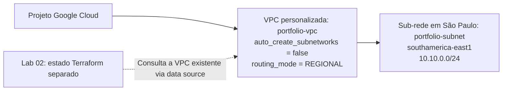

# Laboratório 01 — Rede VPC no Google Cloud

[English](README.md) | [Português (Brasil)](README.pt-BR.md)

Configuração Terraform para uma rede Virtual Private Cloud (VPC) em modo personalizado e uma sub-rede regional no Google Cloud. Este laboratório é independente do protótipo arquivado [`../archive/gcp-secure-infrastructure/`](../archive/gcp-secure-infrastructure/README.md) e deve ser executado a partir de seu próprio diretório, com estado Terraform isolado.

## Objetivo

Projetar e validar uma rede base no Google Cloud utilizando Terraform, desativando a criação automática de sub-redes para garantir planejamento explícito de faixas CIDR, roteamento regional e separação limpa de estado em Infraestrutura como Código.

## Arquitetura

- **VPC em modo personalizado:** `portfolio-vpc` (`auto_create_subnetworks = false`, `routing_mode = "REGIONAL"`).
- **Sub-rede regional:** `portfolio-subnet` com faixa IPv4 `10.10.0.0/24`.
- **Região padrão:** São Paulo (`southamerica-east1`).



### Variáveis (`variables.tf`) e Outputs (`outputs.tf`)

| Tipo | Nome | Descrição | Padrão / Valor |
| --- | --- | --- | --- |
| Variável | `project_id` | ID do projeto de destino no Google Cloud | *(obrigatório)* |
| Variável | `region` | Região onde os recursos de sub-rede são criados | `southamerica-east1` |
| Variável | `network_name` | Nome da rede VPC personalizada | `portfolio-vpc` |
| Variável | `subnet_name` | Nome da sub-rede regional | `portfolio-subnet` |
| Variável | `subnet_cidr` | Faixa de endereços IPv4 (CIDR) da sub-rede | `10.10.0.0/24` |
| Output | `vpc_name` | Nome da rede VPC | `google_compute_network.portfolio_vpc.name` |
| Output | `vpc_id` | Identificador da rede VPC | `google_compute_network.portfolio_vpc.id` |
| Output | `subnet_name` | Nome da sub-rede | `google_compute_subnetwork.portfolio_subnet.name` |
| Output | `subnet_cidr` | Faixa IPv4 (CIDR) da sub-rede | `google_compute_subnetwork.portfolio_subnet.ip_cidr_range` |
| Output | `subnet_region` | Região da sub-rede | `google_compute_subnetwork.portfolio_subnet.region` |

## Origem e status de implementação

Os cinco arquivos Terraform originais foram importados do commit local `3bbe522e141bf5fe9cb505a9a606f0b42b6fb98c` do workspace `GoogleCloudPortfolio`, juntamente com o respectivo `.gitignore`.

**Esta integração não executou implantação de recursos na nuvem.** A existência de estado local no projeto de origem não é apresentada aqui como evidência independente de implantação. O workflow de CI deste laboratório valida formatação e sintaxe da configuração; ele não executa `plan`, `apply` ou `destroy`.

A rede `portfolio-vpc` é consultada via data source pelo [Laboratório 02](../02-secure-compute-engine/README.pt-BR.md). A propriedade da infraestrutura e o ciclo de vida do estado devem ser sempre verificados antes de qualquer novo `apply`.

## Validações Terraform e evidências do GitHub Actions

A formatação local (`terraform fmt -check -recursive`), a inicialização de provedores sem backend com lockfile somente leitura e o `terraform validate` passaram utilizando Terraform `1.17.2` e provedor Google `7.46.2`.

No GitHub Actions ([`01-vpc-network-check.yml`](../../.github/workflows/01-vpc-network-check.yml)), as execuções de `push` e `pull_request` foram concluídas com sucesso em `ubuntu-latest` utilizando Terraform `1.9.8`:

```powershell
terraform fmt -check -recursive
terraform init -backend=false -lockfile=readonly
terraform validate
```

Nenhum comando `plan`, `apply` ou `destroy` foi executado durante a validação de CI.

## Pré-requisitos

- Terraform `1.9.8` ou versão `1.x` compatível (o workflow utiliza `1.9.8`).
- Projeto Google Cloud com faturamento e Compute Engine API habilitados.
- Identidade autenticada com permissão para gerenciar redes VPC no projeto de destino.
- Google Cloud CLI (`gcloud`) para autenticação local via Application Default Credentials, caso execute `plan` ou `apply` localmente.

A restrição do provedor Google é `~> 7.0`, com a versão `7.46.2` fixada em `.terraform.lock.hcl`. O protótipo arquivado [`../archive/gcp-secure-infrastructure/`](../archive/gcp-secure-infrastructure/README.md) mantém sua própria definição de provedor Google `6.x` — **nunca combine arquivos ou estados Terraform entre laboratórios**.

## Validação sem implantação

Execute a partir de `projects/01-vpc-network/`:

```powershell
terraform fmt -check -recursive
terraform init -backend=false -lockfile=readonly
terraform validate
```

A inicialização baixa o binário do provedor para validar tipos e esquemas sem acessar um projeto Google Cloud nem criar recursos na nuvem.

## Implantação manual opcional

Revise o projeto Google Cloud de destino e os nomes dos recursos para evitar conflitos com redes existentes. Nunca execute `apply` para assumir o gerenciamento de uma VPC já controlada por outro estado Terraform.

```powershell
gcloud auth application-default login
terraform init -lockfile=readonly
terraform plan -var="project_id=YOUR_PROJECT_ID"
```

Somente após inspecionar o plano execute `terraform apply -var="project_id=YOUR_PROJECT_ID"`, mantendo a confirmação interativa. Região, nomes e faixa CIDR podem ser ajustados por variáveis. Não armazene credenciais em arquivos Terraform.

## Cuidados com custos e destruição

Execute `terraform destroy -var="project_id=YOUR_PROJECT_ID"` apenas se o estado deste laboratório tiver criado os recursos e após confirmar que nenhum outro laboratório ou carga de trabalho depende da VPC (incluindo o [Laboratório 02](../02-secure-compute-engine/README.pt-BR.md)). Avalie o faturamento do projeto e serviços de rede associados antes de implantar.

Mantenha `.terraform/`, arquivos de estado, planos salvos, credenciais e `*.tfvars` fora do Git. Mantenha o `.terraform.lock.hcl` versionado.

## Checklist de progresso

- [x] Configuração Terraform importada e documentada
- [x] Variáveis de entrada e outputs estruturados
- [x] Formatação local e `terraform validate` aprovados
- [x] Validação automatizada no GitHub Actions (`push` e `pull_request`) aprovada
- [ ] Evidência independente de implantação na nuvem publicada especificamente para este laboratório

**Status: configuração Terraform e CI validados; evidência de implantação independente do Lab 01 não está documentada aqui.**
