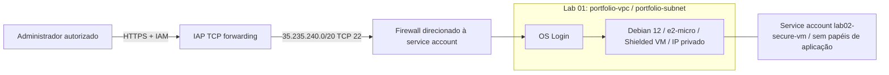

# Laboratório 02 — Secure Compute Engine

Código para uma futura VM Linux privada no projeto `driven-surface-513117-k0`. A implantação depende de autorização explícita, revisão de custos e configuração dos pré-requisitos. Esta entrega não cria recursos GCP nem altera IAM ou APIs.

## Arquitetura e isolamento



| Componente | Configuração |
|---|---|
| Rede existente | `portfolio-vpc`, consultada por data source |
| Subnet existente | `portfolio-subnet`, `southamerica-east1`, `10.10.0.0/24`, consultada por data source |
| VM futura | `lab02-secure-vm`, `southamerica-east1-a`, `e2-micro` |
| Disco | 10 GB `pd-standard`, Debian 12, removido com a VM |
| Recursos gerenciados pelo Lab 02 | Uma VM com disco de boot, uma service account e duas regras de firewall |

A zona aceita apenas `southamerica-east1-a`, `b` ou `c`. Uma precondição confere o CIDR e a associação da subnet à VPC antes de criar a VM. A imagem usa a família Debian 12: a versão resolvida pode mudar entre planos; para produção, avaliar fixar uma imagem específica após testes.

Execute sempre nesta pasta. O Lab 02 tem configuração e lockfile próprios; um eventual state local pertence exclusivamente a ele. Não há `terraform_remote_state`, import, backend compartilhado nem recursos Terraform para criar/gerenciar VPC e subnet. Nunca copie o state do Lab 01 para cá. A dependência de rede continua existindo: remover a subnet/VPC do Lab 01 exige considerar a VM do Lab 02. Os demais projetos do repositório são independentes e não devem ser executados como parte deste laboratório.

## Controles de segurança e limites

- Sem `access_config` e com `IPV4_ONLY`: a VM não recebe IP público nem IPv6.
- SSH via IAP, com allow TCP/22 de `35.235.240.0/20` em prioridade 900. Um deny TCP/22 de `0.0.0.0/0` em prioridade 901 impede que regras VPC de prioridade inferior liberem outras origens. O deny precede inclusive allows comuns de prioridade 1000; números menores têm precedência. Em empate, deny vence allow. Ambas as regras têm como alvo somente a conta dedicada; não reutilize essa conta em outras VMs.
- A VM declara `depends_on` para as duas regras: ambas devem ser criadas antes dela; na destruição normal, a VM é removida antes das regras. Isso ordena operações Terraform, sem garantir propagação instantânea das regras no GCP.
- Antes de implantar, revisar as políticas efetivas, inclusive regras hierárquicas e regras VPC de prioridade superior ou igual. Elas podem sobrepor ou bloquear este desenho. Nenhuma política existente foi inspecionada ou modificada nesta entrega.
- OS Login habilitado somente nos metadados desta VM; chaves SSH de projeto bloqueadas e acesso serial desabilitado. Não há chaves embutidas ou senha no Terraform.
- Secure Boot, vTPM e integrity monitoring habilitados. Isso não instala um agente de observabilidade nem configura alertas.
- Conta `lab02-secure-vm` sem chaves e sem concessões IAM de aplicação. O scope `cloud-platform` é o limite OAuth recomendado pelo Google; as permissões efetivas continuam limitadas pelo IAM. Revisar também concessões herdadas ou existentes antes de implantar. Não há necessidade de Editor, Owner ou papéis de logs/monitoramento para esta VM vazia.
- Sem NAT, proxy, startup script ou instalação de pacotes. O IAP permite entrada administrativa, mas não fornece saída para a internet. Atualizações de pacotes exigem um caminho de saída aprovado separadamente. Private Google Access depende da subnet existente e não é alterado aqui. A regra implícita de saída da VPC não é um controle de restrição de egress; esta configuração não promete isolamento de saída.

## Dependência do Lab 01 e saída da VM

O contrato de rede coincide com os defaults de `../01-vpc-network/variables.tf`: `portfolio-vpc`, `portfolio-subnet`, região `southamerica-east1` e CIDR `10.10.0.0/24`. O projeto do Lab 01 é uma variável obrigatória; deve ser o mesmo `driven-surface-513117-k0` usado aqui. Se as variáveis do Lab 01 forem personalizadas, revisar este contrato antes de qualquer plano. A pasta legada `/01-vpc-network/` não deve ser usada para esta preparação.

A auditoria anterior registrou a subnet existente com **Private Google Access desabilitado**, sem Cloud NAT e com rota `0.0.0.0/0` para o default internet gateway. Isso é contexto da auditoria, não uma consulta cloud desta entrega. O Lab 01 não configura Private Google Access explicitamente; o Lab 02 apenas consulta a subnet e não assume sua gestão.

| Caminho | Limite esperado neste desenho |
|---|---|
| Internet e repositórios Debian | Sem saída direta: IP privado e rota padrão, sozinhos, não fornecem acesso à internet. `apt update` e downloads externos ficam pendentes de saída aprovada. |
| APIs Google por endpoints externos | Sem acesso pela configuração auditada: Private Google Access está desabilitado e não há NAT. Habilitar PGA futuramente exige revisão da subnet do Lab 01 e não libera a internet em geral. |
| IAP de entrada / OS Login | Não exige NAT para o túnel. O administrador acessa as APIs a partir do cliente; o guest usa o servidor de metadados para OS Login. Ainda depende de IAM, firewall, serviços do guest e teste após implantação. |
| Metadados e comunicação interna | Não dependem de NAT; a comunicação interna continua sujeita a rotas e firewalls efetivos. Ausência de NAT não equivale a bloqueio de toda saída. |

Decisão: manter este lab sem NAT, IP público, alterações na subnet ou comandos de atualização no boot. Não apresentar a VM como atualizada ou pronta para produção; antes de uso duradouro, definir uma estratégia autorizada de patches (por exemplo, imagem atualizada e caminho de saída controlado). Remover primeiro os consumidores do Lab 02 antes de uma futura limpeza da rede do Lab 01.

## Pré-requisitos para futura implantação

Um administrador deve revisar e preparar estes requisitos **somente após autorização do usuário**. Nenhum deles é automatizado pelo laboratório.

1. Projeto correto, faturamento ativo, quota/capacidade de VM e disco na região, e rede/subnet existentes confirmadas. A existência foi informada pelo usuário; `validate` não consulta a nuvem.
2. APIs necessárias disponíveis: `compute.googleapis.com`, `iam.googleapis.com`, `iap.googleapis.com` e `oslogin.googleapis.com`. `serviceusage.googleapis.com` é relevante para verificar/gerenciar APIs e quota; habilitação de serviços requer uma identidade administrativa separada. Não há `google_project_service` nesta configuração.
3. Identidade de provisionamento com leitura da rede/subnet e imagens, criação/gestão da VM e disco, uso da subnet, gestão das duas regras de firewall e criação/gestão da service account. Como referência de papéis predefinidos: `roles/compute.instanceAdmin.v1`, `roles/compute.networkUser` e `roles/compute.securityAdmin`, no menor escopo suportado. Esses papéis cobrem mais operações que o lab; prefira permissões customizadas revisadas. Para a SA, `roles/iam.serviceAccountAdmin` permite administrar seu ciclo de vida e política IAM, mas **não inclui** `iam.serviceAccounts.actAs`. Já `roles/iam.serviceAccountUser` inclui `actAs` para anexar a SA à VM, mas não permite administrar a SA. Não conceder esses papéis amplamente por conveniência, nem usar Owner/Editor. O Terraform não concede esses acessos; seguir o bootstrap abaixo.
4. Administrador humano com `roles/iap.tunnelResourceAccessor` restrito à VM (preferencialmente condicionado a `destination.port == 22`), `roles/compute.osLogin` para login normal ou `roles/compute.osAdminLogin` quando sudo for necessário. Se o papel OS Login for concedido na instância, fornecer também `compute.projects.get` no projeto para o uso por console/gcloud. O gcloud precisa descobrir a instância (`compute.instances.get` e `compute.instances.list`); avaliar um papel customizado de leitura. Como esta VM tem uma SA anexada, o OS Login também exige `roles/iam.serviceAccountUser` para o usuário SSH, exclusivamente nessa SA, conforme a documentação do Google. Essa necessidade é distinta do provisionamento e não exige `roles/iam.serviceAccountAdmin`, gestão de firewall ou criação de VMs para o usuário SSH. Se já houver acesso efetivo suficiente, não duplicar a concessão. Para usuários externos à organização, pode ser necessário `roles/compute.osLoginExternalUser` na organização. Separar o usuário que concede acesso do usuário que abre o túnel.
5. Terraform 1.9.8 (CI) ou compatível com `>= 1.9.8, < 2.0.0`; provider Google fixado em `7.46.2`, com checksums próprios de Windows/Linux no lockfile. CLI gcloud e autenticação local via ADC para uma etapa futura; preferir credenciais temporárias, sem exportar chaves JSON.

## Bootstrap mínimo de actAs — somente em futura implantação autorizada

O principal de provisionamento é a identidade que executará Terraform; não é automaticamente o usuário SSH nem a SA da VM. Registrar seu membro IAM exato (`user:EMAIL` ou `serviceAccount:EMAIL`). Um administrador IAM separado deve ter `iam.serviceAccounts.getIamPolicy` e `iam.serviceAccounts.setIamPolicy` na SA dedicada; não conceder gestão de IAM ao usuário SSH para resolver este bootstrap.

1. Após autorização específica e com os pré-requisitos preparados, executar nesta pasta um plano excepcional com `-target=google_service_account.vm`, revisar que ele cria **somente** a SA `lab02-secure-vm` em `driven-surface-513117-k0` e aplicar apenas esse plano aprovado. Isso mantém a SA no state exclusivo do Lab 02, sem criá-la manualmente fora do Terraform. Se ela já estiver nesse state e existir, pular esta criação. O uso de target limita-se a este bootstrap, não à operação normal.
2. Com a SA existente, o administrador IAM separado adiciona `roles/iam.serviceAccountUser` **na política da própria SA** `lab02-secure-vm@driven-surface-513117-k0.iam.gserviceaccount.com`, tendo como membro somente o principal de provisionamento identificado. Usar uma adição de binding que preserve os demais membros; não conceder o papel no projeto, pasta ou organização. Referência para essa etapa futura (substituir o membro; não executado nesta entrega):

   ```powershell
   gcloud iam service-accounts add-iam-policy-binding lab02-secure-vm@driven-surface-513117-k0.iam.gserviceaccount.com --project=driven-surface-513117-k0 --member="user:EMAIL_DO_PROVISIONADOR" --role=roles/iam.serviceAccountUser
   ```

3. Conferir o membro e o escopo do binding, aguardar a propagação IAM e confirmar o acesso efetivo `iam.serviceAccounts.actAs` do provisionador nessa SA. Só então gerar um **novo plano completo, sem target**, revisar VM/disco e as duas regras de firewall restantes e solicitar autorização específica antes de aplicar. Não prosseguir com erro de permissão nem ampliar o escopo do papel como contorno.

A criação inicial exige `iam.serviceAccounts.create` no projeto; a gestão posterior deve limitar-se à SA dedicada, com permissões customizadas revisadas quando possível. O papel `serviceAccountAdmin` é referência de administração, não uma concessão obrigatória ao provisionador ou ao usuário SSH. Nenhum binding, chave ou papel de aplicação para a SA é adicionado ao Terraform.

## Validação sem acesso ao GCP

Na raiz do repositório:

```powershell
cd projects/02-secure-compute-engine
terraform fmt -check -recursive
terraform init -backend=false -lockfile=readonly -input=false
terraform validate
```

Esses comandos verificam sintaxe, formatação e schema do provider. O init baixa o provider do registro, sem backend remoto. Não verificam disponibilidade, IAM, APIs, custo ou políticas efetivas e não leem os data sources no GCP.

O workflow `.github/workflows/02-secure-compute-engine-check.yml` executa os mesmos três checks com Terraform 1.9.8, apenas quando arquivos deste lab/workflow mudam, ou por acionamento manual. Tem apenas `contents: read`, sem credenciais GCP ou autenticação cloud. Não executa plan/apply/destroy. O lockfile deve ficar versionado; sua atualização é uma alteração deliberada a revisar.

Validação local desta preparação (18/11/2026): formatação do Lab 02, init sem backend com lockfile somente para leitura e validate passaram com Terraform 1.17.2 e provider Google 7.46.2. O Lab 01 também passou nos mesmos checks. A checagem adicional de formatação na raiz apontou uma pendência preexistente em `projects/gcp-secure-infrastructure/main.tf`, fora do escopo e preservada. Esta preparação não foi enviada ao GitHub e não tem novo resultado de CI. Não foi executado plan/apply/destroy, autenticação GCP ou consulta dos recursos existentes.

## Operação futura — exige nova autorização

Após revisão e autorização dos pré-requisitos, custos e identidade, a próxima etapa será autenticação ADC e revisão de um plano **somente desta pasta**. Comandos de referência, não executados nesta entrega:

```powershell
gcloud auth application-default login
terraform init -lockfile=readonly
terraform plan
```

Concluir primeiro o bootstrap mínimo de actAs descrito acima. O plano completo lê a VPC/subnet existentes e deve propor somente a VM/disco e as duas regras restantes; a conta dedicada já deve estar no state do Lab 02. Se indicar criação/alteração de VPC, subnet ou qualquer recurso inesperado, interrompa. Revisar o plano antes de pedir autorização específica para apply. Não há aplicação ou destruição automática.

Somente depois de implantação autorizada e IAM preparado, conectar usando:

```powershell
gcloud compute ssh lab02-secure-vm --project=driven-surface-513117-k0 --zone=southamerica-east1-a --tunnel-through-iap
```

Se a zona mudar, ajustar o comando; o output `ssh_command` fornece a zona selecionada. Evidências futuras: ausência de IP externo, três opções Shielded ativas, SSH via IAP funcionando com OS Login e impossibilidade de SSH de outra origem. Essas verificações operacionais ainda estão pendentes e dependem de implantação autorizada.

## Custos e limpeza futura

**Criar esta VM gera cobrança potencial. Não trate `e2-micro` em São Paulo como gratuita.** Calcular antes de implantar: horas de `e2-micro` em `southamerica-east1`, 10 GB de disco persistente, transferência de dados e eventuais serviços adicionados. Consultar preços atuais e configurar orçamento/alertas com aprovação separada; alertas não são limite automático de gastos. NAT não faz parte deste lab e teria custo adicional se incluído depois.

Parar a VM reduz custos de CPU/memória, mas o disco continua cobrado. Planejar uma janela curta de teste. Após autorização específica de limpeza, conferir diretório, projeto e state exclusivos do Lab 02 e revisar um plano de destruição antes de executar qualquer remoção. O disco de boot acompanha a remoção da VM (`auto_delete = true`); dados necessários devem ser preservados antes. A rede/subnet do Lab 01 não pertencem ao state deste lab e devem permanecer. Nunca executar destroy do Lab 01 para limpar este lab.

Não versionar `.terraform/`, state, planos, tfvars, credenciais, chaves ou arquivos locais. JSON legítimo pode ser versionado; para credenciais JSON, usar os nomes específicos ignorados (por exemplo, `credentials.json`, `service-account*.json`, `*-key.json` ou `secrets.json`). O nome não detecta segredos: revisar sempre o conteúdo dos arquivos preparados para commit.

## Referências

- [Ordem explícita de recursos com depends_on](https://developer.hashicorp.com/terraform/language/meta-arguments/depends_on)
- [Prioridade e precedência de regras VPC](https://docs.cloud.google.com/firewall/docs/firewalls)
- [Private Google Access e seus limites](https://docs.cloud.google.com/vpc/docs/private-google-access)
- [OS Login no guest e servidor de metadados](https://github.com/GoogleCloudPlatform/guest-oslogin)

- [IAP TCP forwarding: faixa de origem, IAM e conexão](https://docs.cloud.google.com/iap/docs/using-tcp-forwarding)
- [Configuração do OS Login e papéis necessários](https://docs.cloud.google.com/compute/docs/oslogin/set-up-oslogin)
- [Papéis IAM: Service Account User e Service Account Admin](https://docs.cloud.google.com/iam/docs/roles-permissions/iam)
- [Permissão actAs para anexar service accounts](https://docs.cloud.google.com/iam/docs/service-accounts-actas)
- [Provider Google 7.46.2: Compute Instance](https://registry.terraform.io/providers/hashicorp/google/7.46.2/docs/resources/compute_instance)
- [Boas práticas para service accounts de VM e scopes](https://docs.cloud.google.com/compute/docs/access/service-accounts)
- [Preços de Compute Engine](https://cloud.google.com/compute/all-pricing)
- [Calculadora de custos](https://cloud.google.com/products/calculator)
