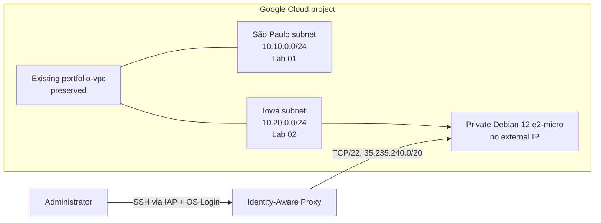

# Lab 02 — Secure Compute Engine in Iowa

[English](README.md) | [Português (Brasil)](README.pt-BR.md)

**Status: deployed and SSH access tested (November 18, 2026).** This lab provisions a private Debian 12 `e2-micro` virtual machine in `us-central1-a` using Terraform. The administrator successfully connected through Identity-Aware Proxy (IAP) and IAM-based OS Login, as reported during the lab. The Iowa deployment was merged in [PR #4](https://github.com/matheuslab-bit/matheuslab-bit/pull/4) after CI checks passed.

This is a **learning environment**, not a production-ready service or a guarantee of zero cloud charges.

## Architecture



| Component | Configuration | Terraform ownership |
| --- | --- | --- |
| Existing VPC | `portfolio-vpc`, read through a data source | Lab 01; preserved |
| São Paulo subnet | `portfolio-subnet`, `southamerica-east1`, `10.10.0.0/24` | Lab 01; preserved |
| Iowa subnet | `lab02-iowa-subnet`, `us-central1`, `10.20.0.0/24` | Lab 02 |
| Virtual machine | `lab02-secure-vm`, `us-central1-a`, `e2-micro` | Lab 02 |
| Boot disk | 10 GB `pd-standard`, Debian 12, auto-delete | Attached to the VM |
| Service account | Dedicated `lab02-secure-vm` service account, no application IAM roles or keys | Lab 02 |
| SSH firewall | Allow IAP at priority 900; deny other IPv4 sources at 901 | Lab 02 |

A VPC is a global resource: adding an Iowa subnet does not migrate the São Paulo subnet. Lab 02 has **its own Terraform state** and must not modify Lab 01's state. The network range was checked for overlap before deployment. The initial expected plan was five additions and no changes or deletions (subnet, service account, two firewall rules and VM).

## Security decisions

- **No public IP or IPv6** is configured for the VM.
- **IAP-only SSH:** TCP/22 allows the IAP range `35.235.240.0/20` at priority 900; a deny rule for `0.0.0.0/0` follows at priority 901. Both target only the VM's dedicated service account. The VM explicitly depends on both rules.
- **OS Login enabled:** project-wide SSH keys are blocked, and serial console access is disabled.
- **Shielded VM:** Secure Boot, vTPM and integrity monitoring are enabled.
- **Identity isolation:** the service account has no application IAM roles, and no keys are created. The `cloud-platform` API scope is not an IAM role.
- **Limited networking:** no Cloud NAT, public IPv4 address, startup script or package installation is provisioned. Private Google Access is disabled on the new subnet only.
- **No automatic permission escalation:** the lab does not grant IAM bindings or enable APIs. Any missing access should be investigated and approved separately.

IAP provides an administrative ingress path, not general internet egress. OS updates and arbitrary package downloads would require a separately approved egress design. Verify effective policies before interpreting a firewall rule as the only applicable control.

## Prerequisites and permissions

The Google Cloud project needs billing, available `e2-micro` capacity in Iowa, the existing VPC, and the Compute Engine, IAM, IAP and OS Login APIs.

The Terraform identity needs read access to the existing VPC/images and narrowly scoped permissions to create the Iowa subnet, VM/disk, firewall rules and dedicated service account, including `iam.serviceAccounts.actAs` for the attached identity. Do not grant `Owner` or `Editor` merely to resolve permissions errors.

For human SSH access, review IAP tunnel access, OS Login (or OS Admin Login for sudo), instance discovery and the required service-account usage permissions.

## Terraform validation and deployment

Run commands **only** from `projects/02-secure-compute-engine/`. The supported Terraform range is `>= 1.9.8, < 2.0.0`. CI uses Terraform 1.9.8 with Google provider **7.46.2** pinned through the committed lockfile.

```powershell
terraform fmt -check -recursive
terraform init -backend=false -lockfile=readonly -input=false
terraform validate
terraform plan -input=false -out=lab02-iowa.tfplan
```

Inspect the saved plan before `terraform apply lab02-iowa.tfplan`. Never apply an obsolete São Paulo plan or run Terraform from the root/other labs. The `-lockfile=readonly` option belongs to `init`, not `plan`.

Connect with IAP after applying:

```powershell
gcloud compute ssh lab02-secure-vm --project=YOUR_PROJECT_ID --zone=us-central1-a --tunnel-through-iap
```

The deployment test confirmed a running private VM and working IAP/OS Login SSH access on November 18, 2026. Verify the VM has no external IP, the 10 GB standard boot disk, the three Shielded settings and the correct Iowa subnet. A follow-up `terraform plan` should show no changes; this remains a recommended drift check unless separately recorded.

## Cost controls

The Google Cloud Free Tier provides limited usage of an eligible non-preemptible `e2-micro` in selected US regions and a shared standard persistent-disk allowance, subject to current billing terms. This lab uses one `e2-micro` in Iowa and a 10 GB `pd-standard` disk, but **Free Tier eligibility is not a guarantee of zero cost**. Shared monthly usage, other projects, traffic, taxes and additional services can incur charges.

This design does not create Cloud NAT, public IPs, snapshots or load balancers. Configure billing budgets and alerts, but note that alerts do not automatically disable billing. Review current pricing before changing the architecture.

## State safety and lifecycle

- Keep Terraform state, `.terraform/`, plans, tfvars, credentials, keys and logs out of Git.
- Maintain a single operational copy of this lab's state; avoid concurrent applies.
- **No destruction or cleanup was authorized as part of this lab.** Preserve the São Paulo VPC/subnet. Review resource ownership before any future removal.
- The Debian 12 image family may resolve to a newer image in later plans. A patching and egress strategy would be needed before claiming production readiness.

## Evidence and history

- [PR #3](https://github.com/matheuslab-bit/matheuslab-bit/pull/3): established firewall ordering and the VM dependency on the allow/deny rules.
- [PR #4](https://github.com/matheuslab-bit/matheuslab-bit/pull/4): merged the Iowa Free Tier-oriented configuration after CI validation.
- November 18, 2026: private VM deployed and IAP/OS Login SSH tested successfully, as recorded during the hands-on session.
- Future improvement: add sanitized verification output or screenshots without project secrets, account identifiers or sensitive metadata.

## References

- [Google Cloud Free Tier](https://docs.cloud.google.com/free/docs/free-cloud-features)
- [Compute Engine pricing](https://cloud.google.com/products/compute/pricing/general-purpose)
- [Persistent disk pricing](https://cloud.google.com/compute/disks-image-pricing)
- [IAP TCP forwarding](https://docs.cloud.google.com/iap/docs/using-tcp-forwarding)
- [OS Login](https://docs.cloud.google.com/compute/docs/oslogin/set-up-oslogin)
- [Service accounts and actAs](https://docs.cloud.google.com/iam/docs/service-accounts-actas)
- [Firewall rules](https://docs.cloud.google.com/firewall/docs/firewalls)
