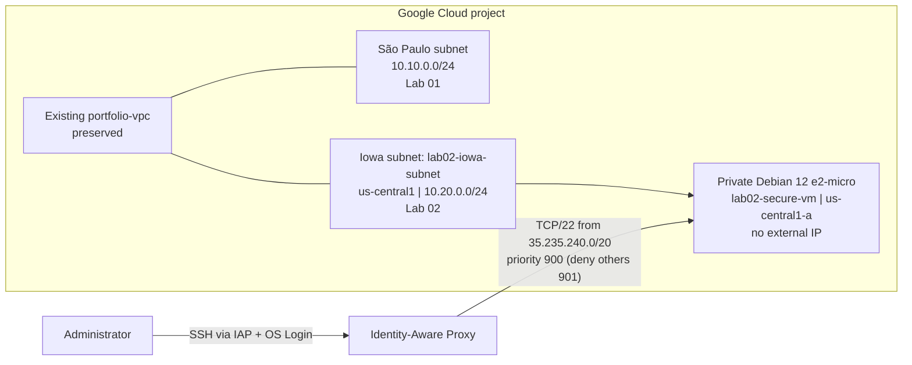

# Lab 02 — Secure Compute Engine in Iowa

[English](README.md) | [Português (Brasil)](README.pt-BR.md)

**Status: deployed and SSH access tested (November 18, 2026).** This lab provisions a private Debian 12 `e2-micro` virtual machine in `us-central1-a` (Iowa) using Terraform. Administrative connection through Identity-Aware Proxy (IAP) and IAM-based OS Login was tested and verified on November 18, 2026. The Iowa configuration was merged in [PR #4](https://github.com/matheuslab-bit/matheuslab-bit/pull/4) after automated CI checks passed.

This is a **learning environment**, not a production-ready service or a guarantee of zero cloud charges.

## Architecture and resource ownership



| Component | Configuration | Terraform ownership |
| --- | --- | --- |
| Existing VPC | `portfolio-vpc`, queried via `data "google_compute_network"` | Lab 01; preserved |
| São Paulo subnet | `portfolio-subnet`, `southamerica-east1`, `10.10.0.0/24` | Lab 01; preserved |
| Iowa subnet | `lab02-iowa-subnet`, `us-central1`, `10.20.0.0/24`, `IPV4_ONLY` | Lab 02 |
| Virtual machine | `lab02-secure-vm`, `us-central1-a`, `e2-micro`, `STANDARD` | Lab 02 |
| Boot disk | 10 GB `pd-standard`, `debian-cloud/debian-12`, `auto_delete = true` | Lab 02 (attached to VM) |
| Service account | Dedicated `lab02-secure-vm`, no application IAM roles or keys | Lab 02 |
| SSH firewall rules | Allow IAP (`35.235.240.0/20`) at priority `900`; deny other IPv4 (`0.0.0.0/0`) at priority `901` | Lab 02 |

A Google Cloud VPC is a global resource: adding a subnet in Iowa (`us-central1`) does not move or modify the existing São Paulo (`southamerica-east1`) subnet. Lab 02 manages its own subnet and **its own Terraform state** without accessing or altering Lab 01's state. Never copy or merge states between labs. The `10.20.0.0/24` range was verified to be free of overlap before deployment.

The initial deployment plan contained **5 additions, 0 changes, and 0 deletions**: subnet, dedicated service account, two firewall rules, and the VM (with its boot disk).

## Security decisions and operational boundaries

- **No public IP or IPv6:** no `access_config` block is present on the network interface (`stack_type = "IPV4_ONLY"`).
- **IAP-only SSH with explicit deny ordering:** TCP/22 ingress is allowed only from `35.235.240.0/20` (IAP TCP forwarding) at priority `900`, immediately followed by an explicit deny rule for `0.0.0.0/0` at priority `901` (preempting common priority-1000 VPC rules). Both rules target only the VM's dedicated service account; do not reuse that service account on other VMs.
- **Explicit firewall dependency:** the VM declares `depends_on` for both firewall rules so SSH controls exist before instance creation. Always review effective hierarchical and VPC firewall policies before deployment.
- **OS Login and metadata hardening:** `enable-oslogin = "TRUE"`, `block-project-ssh-keys = "TRUE"`, and `serial-port-enable = "FALSE"`.
- **Shielded VM enabled:** Secure Boot, vTPM, and integrity monitoring are active. This does not install an observability agent.
- **Identity isolation:** the dedicated service account has no service account keys and no project IAM role bindings. The `cloud-platform` OAuth scope does not grant IAM permissions by itself.
- **No automatic privilege escalation:** this configuration does not create IAM bindings or enable project APIs. Never grant broad roles (`Owner` / `Editor`) as a workaround for permission errors.
- **Controlled network scope:** no Cloud NAT, proxy, startup script, or package installation is provisioned. Private Google Access is explicitly set to `false` on the new Iowa subnet only; the São Paulo subnet is untouched.
- **Ingress vs. egress:** IAP provides administrative SSH ingress, not general internet egress. Debian package updates and external downloads require a separately designed and approved outbound path.
- **Not production-ready:** the `debian-12` image family can resolve to newer image builds in future plans. Without an approved patching, egress, and monitoring strategy, this VM must not be presented as a production workload.

## Prerequisites and permissions

The target Google Cloud project requires active billing, `e2-micro` and standard persistent disk availability in `us-central1`, the existing `portfolio-vpc` network, and the Compute Engine, IAM, IAP, and OS Login APIs enabled.

The identity executing Terraform needs read access to the VPC and public images, plus narrowly scoped permissions to manage the Iowa subnet, VM/disk, firewall rules, and dedicated service account, including `iam.serviceAccounts.actAs` on the attached VM service account.

For administrative SSH connections, the human operator requires IAP tunnel access (`roles/iap.tunnelResourceAccessor`), OS Login (`roles/compute.osLogin` or `roles/compute.osAdminLogin` when sudo is required), Compute instance discovery, and Service Account User (`roles/iam.serviceAccountUser`) scoped to the VM service account.

## Terraform validation and execution

Execute commands **exclusively** from `projects/02-secure-compute-engine/`. Compatible Terraform version range: `>= 1.9.8, < 2.0.0` (GitHub Actions uses `1.9.8`). Google provider version **7.46.2** is pinned via `.terraform.lock.hcl`.

```powershell
terraform fmt -check -recursive
terraform init -backend=false -lockfile=readonly -input=false
terraform validate
terraform plan -input=false -out=lab02-iowa.tfplan
```

Note that `-lockfile=readonly` is an `init` flag, not a `plan` flag. Always inspect the saved plan before running `terraform apply`. Never apply an obsolete plan or run commands from another lab directory.

After deployment, connect via IAP tunnel:

```powershell
gcloud compute ssh lab02-secure-vm --project=YOUR_PROJECT_ID --zone=us-central1-a --tunnel-through-iap
```

During the November 18, 2026 verification, SSH access via IAP and OS Login succeeded, confirming the absence of an external IP, the 10 GB `pd-standard` boot disk, the three Shielded VM protections, and attachment to `lab02-iowa-subnet`. Running a subsequent `terraform plan` is the recommended check to confirm zero configuration drift.

## Cost considerations (Free Tier boundaries)

Google Cloud's Free Tier includes a monthly usage allowance equivalent to one non-preemptible `e2-micro` instance in eligible US regions (`us-central1`, `us-west1`, or `us-east1`) and up to 30 GB-month of standard persistent disk (`pd-standard`), subject to Google Cloud's current billing terms. This lab uses one `e2-micro` in `us-central1-a` and a 10 GB `pd-standard` disk, without public IPv4 addresses, Cloud NAT, snapshots, load balancers, or premium OS images.

**Important cost boundaries:**
- **Free Tier eligibility does not guarantee zero cost.**
- **Allowances are shared** across the billing account: other projects or prior usage in the same month can consume the free quota.
- **Other services and network traffic** (such as egress traffic, taxes, or additional APIs/logs) can still generate charges.
- **Billing budget alerts do not automatically stop charges or disable resources.** Always configure budgets and alerts in Cloud Billing and monitor actual consumption.

## State management and lifecycle

- Keep `.terraform/`, `*.tfstate`, saved plans (`*.tfplan`), `*.tfvars`, credentials, private keys, and logs out of Git.
- Maintain a single operational copy of Lab 02's state and avoid concurrent Terraform runs.
- Preserve the existing VPC and São Paulo subnet managed by Lab 01; never run `terraform destroy` on Lab 01 to clean up Lab 02 resources. Any future teardown of Lab 02 requires explicit review of affected resources.

## Evidence and history

- **[PR #2](https://github.com/matheuslab-bit/matheuslab-bit/pull/2) & [PR #3](https://github.com/matheuslab-bit/matheuslab-bit/pull/3):** established the standalone Lab 02 structure, priority `900`/`901` SSH firewall ordering, and explicit VM dependency on both firewall rules.
- **[PR #4](https://github.com/matheuslab-bit/matheuslab-bit/pull/4):** adapted Lab 02 to `us-central1` (Iowa) with a dedicated subnet (`10.20.0.0/24`) after CI validation passed.
- **November 18, 2026:** private VM deployed in Iowa and administrative SSH via IAP + OS Login tested and confirmed.

## References

- [Google Cloud Free Tier](https://docs.cloud.google.com/free/docs/free-cloud-features)
- [Compute Engine general-purpose pricing](https://cloud.google.com/products/compute/pricing/general-purpose)
- [Persistent disk and image pricing](https://cloud.google.com/compute/disks-image-pricing)
- [IAP TCP forwarding](https://docs.cloud.google.com/iap/docs/using-tcp-forwarding)
- [OS Login setup](https://docs.cloud.google.com/compute/docs/oslogin/set-up-oslogin)
- [Service accounts and `actAs`](https://docs.cloud.google.com/iam/docs/service-accounts-actas)
- [VPC firewall rules and priorities](https://docs.cloud.google.com/firewall/docs/firewalls)
