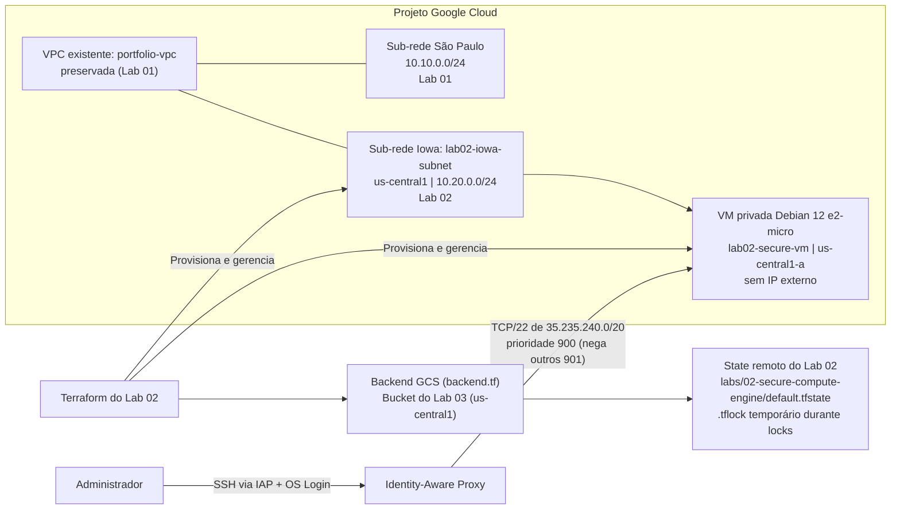

# Laboratório 02 — Secure Compute Engine em Iowa

[English](README.md) | [Português (Brasil)](README.pt-BR.md)

**Status: implantado em Iowa (`us-central1-a`), acesso SSH via IAP/OS Login testado (18 de novembro de 2026) e estado Terraform migrado para o Google Cloud Storage (`labs/02-secure-compute-engine`) em 20 de novembro de 2026.**

Este laboratório provisiona uma máquina virtual privada Debian 12 `e2-micro` em `us-central1-a` (Iowa) utilizando Terraform. A configuração Terraform para Iowa foi integrada no [PR #4](https://github.com/matheuslab-bit/matheuslab-bit/pull/4) após aprovação das verificações automatizadas de CI; após o merge, a infraestrutura foi implantada no Google Cloud e a conexão administrativa por meio do Identity-Aware Proxy (IAP) e do OS Login baseado em IAM foi testada e validada em 18/11/2026. Em 20/11/2026, o estado Terraform foi migrado localmente via `terraform init -migrate-state` para o backend GCS endurecido do [Laboratório 03](../03-terraform-backend/README.pt-BR.md), e o arquivo `backend.tf` foi versionado no [PR #10](https://github.com/matheuslab-bit/matheuslab-bit/pull/10).

Este é um **ambiente de aprendizado**, não um serviço pronto para produção nem uma garantia de custo zero na nuvem.

## Arquitetura e Propriedade dos Recursos



| Componente | Configuração | Gestão Terraform |
| --- | --- | --- |
| VPC existente | `portfolio-vpc`, consultada por `data "google_compute_network"` | Lab 01; preservada |
| Sub-rede de São Paulo | `portfolio-subnet`, `southamerica-east1`, `10.10.0.0/24` | Lab 01; preservada |
| Sub-rede de Iowa | `lab02-iowa-subnet`, `us-central1`, `10.20.0.0/24`, `IPV4_ONLY` | Lab 02 |
| Máquina virtual | `lab02-secure-vm`, `us-central1-a`, `e2-micro`, `STANDARD` | Lab 02 |
| Disco de boot | 10 GB `pd-standard`, `debian-cloud/debian-12`, `auto_delete = true` | Lab 02 (anexado à VM) |
| Conta de serviço | `lab02-secure-vm` dedicada, sem chaves ou papéis IAM de aplicação | Lab 02 |
| Regras de firewall SSH | Allow IAP (`35.235.240.0/20`) prioridade `900`; deny outras origens IPv4 (`0.0.0.0/0`) prioridade `901` | Lab 02 |
| Backend de estado remoto | `gs://gcp-portfolio-tfstate-usc1-7f4e9a2c`, prefixo `labs/02-secure-compute-engine` (`backend.tf`) | Bucket do Lab 03; state do Lab 02 |

Uma VPC no Google Cloud é um recurso global: adicionar uma sub-rede em Iowa (`us-central1`) não move nem modifica a sub-rede existente em São Paulo (`southamerica-east1`). O Lab 02 gerencia sua própria sub-rede e **seu próprio prefixo isolado de estado no GCS** (`labs/02-secure-compute-engine`), sem alterar o estado do Lab 01 (`labs/01-vpc-network`).

## Decisões de Segurança e Limites Operacionais

- **Sem IP público e sem IPv6:** nenhum bloco `access_config` está configurado na interface de rede (`stack_type = "IPV4_ONLY"`).
- **SSH exclusivo por IAP com negação explícita:** o tráfego de entrada TCP/22 é permitido apenas a partir de `35.235.240.0/20` (encaminhamento TCP do IAP) na prioridade `900`, seguido imediatamente por uma regra explícita de bloqueio para `0.0.0.0/0` na prioridade `901` (precedendo regras comuns de prioridade 1000 na VPC). Ambas as regras têm como alvo exclusivo a conta de serviço dedicada da VM; não reutilize essa conta em outras VMs.
- **Dependência explícita do firewall:** a VM declara `depends_on` para as duas regras de firewall, garantindo que os controles de SSH existam antes da criação da instância. Revise sempre políticas hierárquicas e regras de prioridade superior antes de implantar.
- **OS Login e endurecimento de metadados:** `enable-oslogin = "TRUE"`, `block-project-ssh-keys = "TRUE"` e `serial-port-enable = "FALSE"`.
- **Shielded VM ativa:** Secure Boot, vTPM e monitoramento de integridade habilitados. Isso não instala agente de observabilidade.
- **Isolamento de identidade:** a conta de serviço dedicada não possui chaves geradas nem concessões de papéis IAM no projeto. O escopo OAuth `cloud-platform` não concede papéis IAM por si só.
- **Sem Project ID fixo no código:** `project_id` é uma variável obrigatória validada por expressão regular e fornecida localmente via `terraform.tfvars` (copiado de `terraform.tfvars.example` e ignorado pelo Git).
- **Escopo de rede controlado:** não são provisionados Cloud NAT, proxy, startup script ou instalação de pacotes. O Private Google Access está explicitamente definido como `false` apenas na nova sub-rede de Iowa; a sub-rede de São Paulo permanece inalterada.
- **Entrada vs. saída de rede:** o IAP fornece entrada administrativa para SSH, não saída geral para a internet. Atualizações de pacotes Debian e downloads externos exigem um caminho de saída projetado e aprovado separadamente.
- **Não pronta para produção:** a família de imagens `debian-12` pode resolver para versões mais recentes em planos futuros. Sem uma estratégia aprovada de atualização de pacotes, saída de rede e monitoramento, esta VM não deve ser apresentada como pronta para produção.

## Scan de Segurança e Riscos Aceitos

O workflow compartilhado [`terraform-ci.yml`](../../.github/workflows/terraform-ci.yml) executa o Checkov neste laboratório: **22 verificações são aprovadas** (sem IP público, sem conta de serviço padrão, OS Login, chaves SSH do projeto bloqueadas, porta serial desativada, Shielded VM, sem entrada SSH/RDP irrestrita, entre outras). Os demais achados são riscos aceitos, documentados com `#checkov:skip` no próprio [`main.tf`](main.tf):

| Verificação | Decisão |
| --- | --- |
| `CKV_GCP_26` — VPC Flow Logs | Adiado para o laboratório de monitoramento planejado, evitando custos de ingestão de logs. |
| `CKV_GCP_74` — Private Google Access | Desativado intencionalmente; a VM não possui caminho de saída aprovado neste laboratório. |
| `CKV_GCP_38` — Criptografia de disco com chaves do cliente | O disco de boot usa criptografia gerenciada pelo Google; chaves gerenciadas pelo cliente estão planejadas para um futuro laboratório de Cloud KMS. |

## Pré-requisitos e Permissões

O projeto Google Cloud de destino requer faturamento ativo, disponibilidade de `e2-micro` e disco padrão em `us-central1`, a rede `portfolio-vpc` existente, o bucket de estado remoto do Lab 03 e as APIs Compute Engine, IAM, IAP e OS Login habilitadas.

A identidade que executa o Terraform precisa de permissão de leitura e escrita de objetos no bucket de estado (`roles/storage.objectAdmin` no bucket para leitura/gravação do state e bloqueio `.tflock`), acesso de leitura à VPC e às imagens públicas, além de permissões restritas para gerenciar a sub-rede de Iowa, a VM/disco, as regras de firewall e a conta de serviço dedicada, incluindo `iam.serviceAccounts.actAs` na conta anexada à VM.

Para conexões administrativas via SSH, o operador humano precisa de permissão de túnel IAP (`roles/iap.tunnelResourceAccessor`), OS Login (`roles/compute.osLogin` ou `roles/compute.osAdminLogin` quando necessário `sudo`), descoberta da instância no Compute Engine e papel de Service Account User (`roles/iam.serviceAccountUser`) restrito à conta de serviço da VM.

## Validação e Execução com Terraform

Execute os comandos **exclusivamente** a partir de `projects/02-secure-compute-engine/`. Faixa de versão compatível do Terraform: `>= 1.9.8, < 2.0.0` (o GitHub Actions utiliza `1.9.8`). O provedor Google **7.46.2** está fixado em `.terraform.lock.hcl`.

Para validação estática sem credenciais de nuvem (como executado no GitHub Actions):

```powershell
terraform fmt -check -recursive
terraform init -backend=false -lockfile=readonly -input=false
terraform validate
```

Para operação autenticada conectada ao backend remoto GCS:

```powershell
Copy-Item terraform.tfvars.example terraform.tfvars
# Edite terraform.tfvars localmente com seu project_id real
terraform init -lockfile=readonly -input=false
terraform plan -input=false
```

Conecte-se via túnel IAP:

```powershell
gcloud compute ssh lab02-secure-vm --project=YOUR_PROJECT_ID --zone=us-central1-a --tunnel-through-iap
```

No teste realizado em 18 de novembro de 2026, o acesso SSH via IAP e OS Login foi concluído com sucesso, confirmando a ausência de IP externo, o disco de boot `pd-standard` de 10 GB, as três proteções Shielded VM e a conexão à sub-rede `lab02-iowa-subnet`. Após a migração do estado para o GCS em 20 de novembro de 2026, o `terraform plan` confirmou `No changes. Your infrastructure matches the configuration.`

## Considerações de Custos (Limites do Free Tier)

O Free Tier do Google Cloud inclui uma franquia mensal equivalente a uma instância `e2-micro` não preemptiva em regiões elegíveis dos EUA (`us-central1`, `us-west1` ou `us-east1`) e até 30 GB-mês de disco persistente padrão (`pd-standard`), conforme os termos vigentes de faturamento do Google Cloud. Este laboratório utiliza uma `e2-micro` em `us-central1-a` e um disco `pd-standard` de 10 GB, sem endereço IPv4 público, Cloud NAT, snapshots, balanceador de carga ou imagem de sistema operacional paga.

**Limites importantes de custo:**
- **A elegibilidade ao Free Tier não garante custo zero.**
- **A franquia é compartilhada** na conta de faturamento: outros projetos ou uso anterior no mesmo mês podem consumir o limite gratuito.
- **Outros serviços e tráfego de rede** (como tráfego de saída, tributos ou APIs/logs adicionais) podem gerar cobranças.
- **Alertas de orçamento não bloqueiam cobranças nem desligam recursos automaticamente.** Configure orçamentos e alertas no Cloud Billing e acompanhe o consumo real.

## Gerenciamento de Estado Remoto e Ciclo de Vida

- O estado do Lab 02 é armazenado remotamente em `gs://gcp-portfolio-tfstate-usc1-7f4e9a2c/labs/02-secure-compute-engine/default.tfstate` (`backend.tf`), protegido por versionamento de objetos no GCS, regra de ciclo de vida de 90 dias para versões não atuais, política explícita de Soft Delete de 7 dias e bloqueio nativo `.tflock`.
- Mantenha `.terraform/`, backups locais de estado (`*.tfstate*`), planos salvos (`*.tfplan`), `*.tfvars`, credenciais, chaves privadas e logs fora do Git.
- Preserve a VPC existente e a sub-rede de São Paulo gerenciadas pelo Lab 01; nunca execute `terraform destroy` no Lab 01 para remover recursos do Lab 02.

## Evidências e Histórico

- **[PR #2](https://github.com/matheuslab-bit/matheuslab-bit/pull/2) e [PR #3](https://github.com/matheuslab-bit/matheuslab-bit/pull/3):** estabeleceram a estrutura independente do Lab 02, a ordenação das regras de firewall SSH com prioridades `900`/`901` e a dependência explícita da VM em relação às duas regras.
- **[PR #4](https://github.com/matheuslab-bit/matheuslab-bit/pull/4):** integrou a configuração Terraform adaptando o Lab 02 para `us-central1` (Iowa) com sub-rede dedicada (`10.20.0.0/24`) após aprovação na validação de CI.
- **18 de novembro de 2026 (Implantação no GCP e Validação SSH via IAP/OS Login):** após o merge do [PR #4](https://github.com/matheuslab-bit/matheuslab-bit/pull/4), a infraestrutura foi efetivamente implantada no Google Cloud (Iowa) e o acesso administrativo SSH via IAP e OS Login foi testado e validado.
- **20 de novembro de 2026 (Migração Local de State e [PR #10](https://github.com/matheuslab-bit/matheuslab-bit/pull/10)):** migração efetiva do estado Terraform do Lab 02 executada localmente com `terraform init -migrate-state` para o bucket GCS endurecido (`labs/02-secure-compute-engine`) com desvio zero (`No changes`), e configuração `backend.tf` versionada no [PR #10](https://github.com/matheuslab-bit/matheuslab-bit/pull/10).

## Referências

- [Free Tier do Google Cloud e limites compartilhados](https://docs.cloud.google.com/free/docs/free-cloud-features?hl=pt-br)
- [Preços de VMs de uso geral do Compute Engine](https://cloud.google.com/products/compute/pricing/general-purpose)
- [Preços de discos persistentes e imagens](https://cloud.google.com/compute/disks-image-pricing)
- [Encaminhamento TCP com IAP](https://docs.cloud.google.com/iap/docs/using-tcp-forwarding)
- [Configuração do OS Login](https://docs.cloud.google.com/compute/docs/oslogin/set-up-oslogin)
- [Contas de serviço e permissão `actAs`](https://docs.cloud.google.com/iam/docs/service-accounts-actas)
- [Regras e prioridades de firewall de VPC](https://docs.cloud.google.com/firewall/docs/firewalls)
