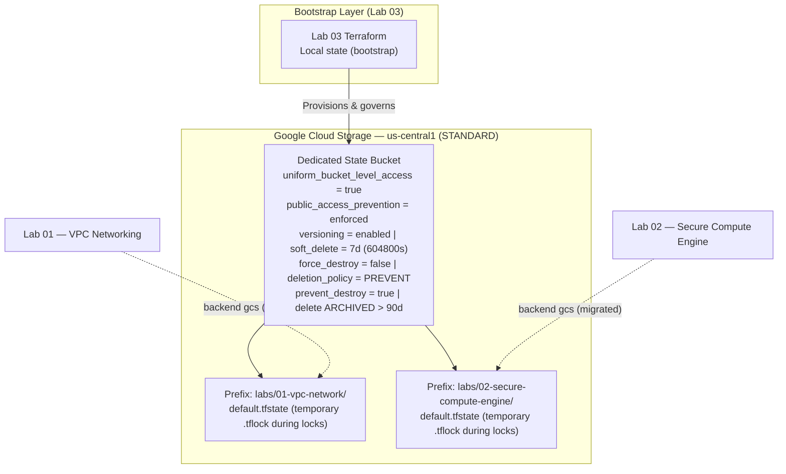

# Lab 03 — Terraform Remote State with Google Cloud Storage

[English](README.md) | [Português (Brasil)](README.pt-BR.md)

**Status: deployed in Iowa (`us-central1`) on November 20, 2026; stores the active remote Terraform state objects for Lab 01 (`labs/01-vpc-network`) and Lab 02 (`labs/02-secure-compute-engine`), with temporary `.tflock` objects created during state-locking operations.**

This lab provisions a dedicated, security-hardened **Google Cloud Storage (GCS)** bucket in `us-central1` (Iowa) that stores the remote Terraform state files for the portfolio labs. The configuration and CI workflow were merged in [PR #9](https://github.com/matheuslab-bit/matheuslab-bit/pull/9); on November 20, 2026, the bucket was deployed locally, the states of Labs 01 and 02 were migrated locally via `terraform init -migrate-state`, and the `backend.tf` files for Labs 01 and 02 were versioned in [PR #10](https://github.com/matheuslab-bit/matheuslab-bit/pull/10).

## Objective

Replace fragile local `.tfstate` files in downstream labs with a centralized, versioned, and access-controlled GCS backend that provides native state locking, historical version recovery, and lifecycle cost governance.

## Architecture



### Bootstrap Bucket vs. Downstream Lab Backends

A foundational question in Infrastructure as Code is: *who stores the state of the state bucket?*

- **Bootstrap state (this lab — Lab 03):** intentionally keeps its own `terraform.tfstate` **local** (with a local backup copy stored in a separate directory outside the repository; note that a local copy on the same drive does not protect against physical disk failure). Storing a bucket's state inside the bucket itself creates a circular dependency during initial creation, recovery, or destruction. Because Lab 03 manages only a single, stable `google_storage_bucket` resource, a local state with a separate local backup is simple, auditable, and avoids self-referential lockouts.
- **Downstream labs (Labs 01, 02, and future labs):** with the Lab 03 bucket deployed, [Lab 01](../01-vpc-network/README.md) and [Lab 02](../02-secure-compute-engine/README.md) configure `backend "gcs"` blocks (`backend.tf`) pointing to the shared bucket with **isolated prefixes** (`labs/01-vpc-network` and `labs/02-secure-compute-engine`). Each lab maintains an independent state lifecycle inside the same hardened bucket.

## How the GCS Backend Works

### State Locking
When a lab uses `backend "gcs"`, Terraform automatically acquires a distributed lock before any operation that writes state (`plan`, `apply`, `destroy`, `import`). It does this by creating a temporary `.tflock` object next to `default.tfstate` using GCS object generation preconditions. If a second run starts concurrently, Terraform aborts immediately rather than corrupting the state.

### Object Versioning, 90-Day Lifecycle Policy, and 7-Day Soft Delete
- **Object Versioning (`versioning.enabled = true`):** every `terraform apply` writes a new live object generation (`default.tfstate`). The previous state is not overwritten in place; instead, GCS marks it as a **noncurrent (`ARCHIVED`)** version with a unique generation number.
- **90-Day Noncurrent Lifecycle Rule (`days_since_noncurrent_time = 90`, `with_state = "ARCHIVED"`):**
  - **Active state safety:** the current (`LIVE`) state file is **never** deleted by this lifecycle rule, regardless of how many months pass without a new `terraform apply`.
  - **Asynchronous lifecycle execution:** GCS evaluates and executes object lifecycle rules **asynchronously** in background batches, without a guaranteed exact completion timeframe after the 90-day condition is met.
- **Explicit 7-Day Soft Delete (`soft_delete_policy.retention_duration_seconds = 604800`):**
  - Configured explicitly in Terraform (604,800 seconds = 7 days) rather than relying on an implicit cloud default.
  - When an `ARCHIVED` state version is deleted by the 90-day lifecycle rule (or if an object is manually deleted), it transitions to a **soft-deleted** state for an additional **7 days** before permanent purge.
  - **End-to-end retention timeline:** a superseded state version remains recoverable as a noncurrent version for **90 days** (+ asynchronous lifecycle processing time), followed by **7 days** in the soft-deleted recovery window before permanent elimination.

## Security and Permissions

### Bucket Hardening Controls
- **`uniform_bucket_level_access = true`:** disables legacy per-object ACLs so all access is governed strictly through bucket-level and project-level IAM policies.
- **`public_access_prevention = "enforced"`:** blocks `allUsers` and `allAuthenticatedUsers` bindings at the bucket level, preventing accidental public exposure of Terraform state.
- **`force_destroy = false`:** prevents Terraform from emptying and deleting the bucket while it still contains live or archived state objects.
- **`deletion_policy = "PREVENT"`:** enforces provider-level deletion protection in Google provider `7.46.2`, blocking bucket deletion requests even during destroy operations.
- **`lifecycle.prevent_destroy = true`:** causes Terraform's core engine to reject any execution plan that attempts to destroy the state bucket. **Important boundary:** `prevent_destroy`, `deletion_policy = "PREVENT"`, and `force_destroy = false` guard against accidental destruction triggered through Terraform; they do **not** replace state backups (note that local backups stored outside the repository on the same disk do not protect against physical drive failure) and do **not** prevent manual deletion performed outside Terraform (such as via the Google Cloud Console, `gcloud storage rm`, or direct API calls by privileged identities).
- **No hardcoded identifiers or personal data:** both `project_id` and `bucket_name` are required input variables supplied locally via `terraform.tfvars` (ignored by Git). Use an opaque, non-identifying bucket name (for example, `gcp-portfolio-tfstate-usc1-<random-suffix>`) that does not embed your Google Cloud Project ID or personal information.

### Required IAM Permissions
- **To provision the bucket (Lab 03):** the Terraform identity needs `storage.buckets.create`, `storage.buckets.get`, and `storage.buckets.update` in the target project (for example, `roles/storage.admin` scoped to the project or a custom bootstrap role).
- **To consume the backend in other labs (`plan` / `apply`):** the operator or CI identity needs object read/write access on the bucket (`roles/storage.objectAdmin` on the specific bucket, or `storage.objects.get`, `storage.objects.list`, `storage.objects.create`, and `storage.objects.delete`).
- **For CI validation (`terraform plan` via Workload Identity Federation in a future lab):** even a read-only `terraform plan` against a GCS backend must acquire and release the distributed state lock by creating and deleting the `.tflock` object (`storage.objects.create` and `storage.objects.delete` on the state prefix). Disabling state locking is not recommended for a shared remote state because concurrent runs could read inconsistent state or collide with an active operation.
- **To restore soft-deleted state objects:** the operator requires `storage.objects.list`, `storage.objects.get`, `storage.objects.restore`, and `storage.objects.create` on the bucket.

## Cost Considerations and Free Tier

Google Cloud's Free Tier includes **5 GB-months of Regional Standard Storage** per month in eligible US regions (including `us-central1`), plus monthly allowances of Class A and Class B operations, subject to current Google Cloud billing terms.

- The migrated Terraform state files for Labs 01 and 02 total **~24 KB** (`4.88 KB` + `19.10 KB`, < 0.001% of 5 GB).
- Even with dozens of noncurrent versions retained for 90 days, total storage remains well under 5 MB.
- **Important boundaries:** Free Tier quotas are shared across the billing account; exceeding operation limits, cross-region egress, or usage in other projects can incur charges. Billing alerts do not automatically block spending.

## State Recovery Procedure

> **Precaution before any recovery:** always copy or download the current live `default.tfstate` (if present) to a separate backup location before restoring an older generation. Preserving the current state ensures you can inspect differences and avoid irreversible loss if the wrong generation is selected.

### A. Restoring a Noncurrent (`ARCHIVED`) Version (Within the 90-Day Lifecycle Window)

1. **Preserve the current live state** (if it exists) before overwriting it:
   ```powershell
   gcloud storage cp gs://YOUR_BUCKET_NAME/labs/01-vpc-network/default.tfstate ./pre-recovery-default.tfstate.bak
   ```
2. **List available live and noncurrent object generations** for the affected lab prefix:
   ```powershell
   gcloud storage ls --all-versions gs://YOUR_BUCKET_NAME/labs/01-vpc-network/default.tfstate
   ```
3. **Inspect timestamps and identify the last known-good `<GENERATION>` number.**
4. **Copy the selected noncurrent generation back as the active state object:**
   ```powershell
   gcloud storage cp gs://YOUR_BUCKET_NAME/labs/01-vpc-network/default.tfstate#<GENERATION> gs://YOUR_BUCKET_NAME/labs/01-vpc-network/default.tfstate
   ```
5. **Verify from the lab directory** with `terraform plan` to confirm the restored state matches the live cloud resources.

### B. Restoring a Soft-Deleted Version (Within the 7-Day Soft Delete Window)

If a state object or an archived generation was deleted (either manually or by the 90-day lifecycle rule), it remains recoverable in the soft-deleted state for **7 days** (`retention_duration_seconds = 604800`). Restoring requires `storage.objects.list`, `storage.objects.get`, `storage.objects.restore`, and `storage.objects.create` permissions on the bucket.

1. **Preserve the current live state** (if present) before restoring over the active path:
   ```powershell
   gcloud storage cp gs://YOUR_BUCKET_NAME/labs/01-vpc-network/default.tfstate ./pre-soft-restore-default.tfstate.bak
   ```
2. **List soft-deleted object generations** for the affected state path:
   ```powershell
   gcloud storage ls --soft-deleted gs://YOUR_BUCKET_NAME/labs/01-vpc-network/default.tfstate
   ```
3. **Identify the target `<GENERATION>` number from the soft-deleted list and restore it:**
   ```powershell
   gcloud storage restore gs://YOUR_BUCKET_NAME/labs/01-vpc-network/default.tfstate#<GENERATION>
   ```
4. **Verify from the lab directory** with `terraform plan` to confirm the restored state aligns with the deployed cloud resources.

## Validation and Execution

Run commands exclusively from `projects/03-terraform-backend/`:

```powershell
terraform fmt -check -recursive
terraform init -backend=false -lockfile=readonly -input=false
terraform validate
```

To inspect or plan against the deployed bootstrap state using your local untracked `terraform.tfvars` (copied from `terraform.tfvars.example`):

```powershell
Copy-Item terraform.tfvars.example terraform.tfvars
# Edit terraform.tfvars locally with your real project_id and globally unique bucket_name
terraform plan -input=false
```

Do not commit `terraform.tfvars`, `*.tfplan`, or `*.tfstate`.

## Progress Checklist

- [x] Terraform configuration authored (`versions.tf`, `variables.tf`, `main.tf`, `outputs.tf`, `terraform.tfvars.example`)
- [x] Bilingual documentation authored (`README.md` and `README.pt-BR.md`)
- [x] `terraform fmt -check`, `terraform init -backend=false`, and `terraform validate` verified locally and in GitHub Actions ([PR #9](https://github.com/matheuslab-bit/matheuslab-bit/pull/9))
- [x] Bucket creation authorized and applied in Google Cloud (`us-central1`, November 20, 2026)
- [x] Lab 01 and Lab 02 states migrated locally via `terraform init -migrate-state` (`No changes` verified) and `backend.tf` files versioned in [PR #10](https://github.com/matheuslab-bit/matheuslab-bit/pull/10)
