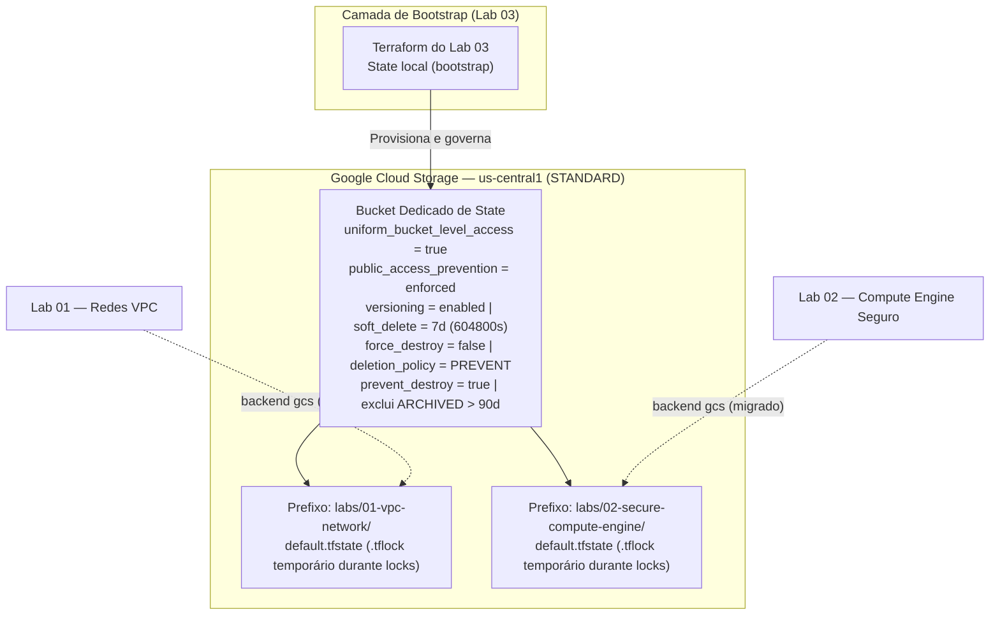

# Laboratório 03 — Terraform Remote State com Google Cloud Storage

[English](README.md) | [Português (Brasil)](README.pt-BR.md)

**Status: implantado em Iowa (`us-central1`) em 20 de novembro de 2026; armazena os objetos ativos de estado remoto do Terraform do Lab 01 (`labs/01-vpc-network`) e do Lab 02 (`labs/02-secure-compute-engine`), com objetos temporários `.tflock` utilizados durante operações que exigem state locking.**

Este laboratório provisiona um bucket dedicado e endurecido no **Google Cloud Storage (GCS)** na região `us-central1` (Iowa) que armazena remotamente os arquivos de estado do Terraform dos laboratórios do portfólio. A configuração e o workflow de CI foram integrados no [PR #9](https://github.com/matheuslab-bit/matheuslab-bit/pull/9); em 20/11/2026, o bucket foi implantado localmente, os estados dos Labs 01 e 02 foram migrados localmente com `terraform init -migrate-state` e os arquivos `backend.tf` dos Labs 01 e 02 foram versionados no [PR #10](https://github.com/matheuslab-bit/matheuslab-bit/pull/10).

## Objetivo

Substituir arquivos `.tfstate` locais nos laboratórios seguintes por um backend remoto centralizado no GCS, com versionamento de objetos, bloqueio nativo de estado (*state locking*), controle de acesso uniforme e política de ciclo de vida para governança de custos.

## Arquitetura



### Diferença entre Bucket de Bootstrap e Backend dos Outros Laboratórios

Uma decisão arquitetural fundamental em Infraestrutura como Código é: *onde fica armazenado o estado do próprio bucket de estados?*

- **Estado de bootstrap (este laboratório — Lab 03):** mantém intencionalmente seu próprio `terraform.tfstate` **local** (com cópia de backup local em diretório separado fora do repositório; observe que uma cópia no mesmo disco físico não protege contra falha física da unidade). Armazenar o estado do bucket dentro dele mesmo cria uma dependência circular durante a criação inicial, recuperação de desastres ou eventual destruição. Como o Lab 03 gerencia apenas um único recurso estável (`google_storage_bucket`), manter o estado de bootstrap local com backup local separado do repositório é simples, auditável e evita bloqueios autorreferenciais.
- **Demais laboratórios (Labs 01, 02 e futuros):** com o bucket do Lab 03 implantado, o [Laboratório 01](../01-vpc-network/README.pt-BR.md) e o [Laboratório 02](../02-secure-compute-engine/README.pt-BR.md) configuram blocos `backend "gcs"` (`backend.tf`) apontando para o bucket compartilhado com **prefixos isolados** (`labs/01-vpc-network` e `labs/02-secure-compute-engine`). Assim, cada laboratório mantém seu ciclo de vida e seu estado totalmente independentes dentro do mesmo bucket protegido.

## Funcionamento do GCS Backend

### Bloqueio de Estado (State Locking)
Quando um laboratório utiliza `backend "gcs"`, o Terraform adquire automaticamente um bloqueio distribuído antes de qualquer operação que modifique ou planeje sobre o estado (`plan`, `apply`, `destroy`, `import`). Para isso, ele cria um objeto temporário `.tflock` ao lado do `default.tfstate` usando pré-condições atômicas do GCS. Se uma segunda execução for iniciada simultaneamente, o Terraform interrompe a operação imediatamente, impedindo corrupção do estado.

### Versionamento de Objetos, Ciclo de Vida de 90 Dias e Soft Delete de 7 Dias
- **Versionamento (`versioning.enabled = true`):** cada `terraform apply` grava uma nova geração ativa (`default.tfstate`). O estado anterior não é perdido: o GCS o preserva como uma versão **não atual (`ARCHIVED`)** identificada por um número exclusivo de geração (`generation`).
- **Regra de ciclo de vida de 90 dias para versões `ARCHIVED` (`days_since_noncurrent_time = 90`, `with_state = "ARCHIVED"`):**
  - **Proteção do estado ativo:** a versão atual (`LIVE`) do estado **nunca** é excluída por essa regra de ciclo de vida, independentemente de quanto tempo passe sem um novo `terraform apply`.
  - **Execução assíncrona do ciclo de vida:** no Cloud Storage, a inspeção e aplicação das regras de `lifecycle_rule` ocorrem de forma **assíncrona** em segundo plano, sem prazo exato garantido para conclusão após a condição de 90 dias ser atingida.
- **Política explícita de Soft Delete de 7 dias (`soft_delete_policy.retention_duration_seconds = 604800`):**
  - Declarada explicitamente no Terraform (604.800 segundos = 7 dias) para não depender de valores padrões implícitos da nuvem.
  - Quando uma versão `ARCHIVED` é removida pela regra de ciclo de vida de 90 dias (ou caso um objeto seja excluído manualmente), ela permanece retida em estado *soft-deleted* por mais **7 dias** antes da eliminação definitiva.
  - **Linha do tempo completa de retenção:** uma versão substituída permanece recuperável como versão não atual por **90 dias** (+ tempo de processamento assíncrono do ciclo de vida), seguidos por mais **7 dias** na retenção do Soft Delete antes da purga permanente.

## Segurança e Permissões

### Controles de Endurecimento do Bucket
- **`uniform_bucket_level_access = true`:** desativa ACLs legadas por objeto, garantindo que todo o controle de acesso seja gerenciado exclusivamente via políticas IAM de bucket e projeto.
- **`public_access_prevention = "enforced"`:** bloqueia vínculos `allUsers` e `allAuthenticatedUsers` no bucket, impedindo exposição pública acidental dos estados do Terraform.
- **`force_destroy = false`:** impede que o Terraform esvazie e exclua o bucket enquanto ainda existirem objetos de estado ativos ou arquivados dentro dele.
- **`deletion_policy = "PREVENT"`:** aplica proteção contra exclusão no nível do provedor Google `7.46.2`, bloqueando chamadas de remoção do bucket mesmo em operações de destroy.
- **`lifecycle.prevent_destroy = true`:** faz com que o motor do Terraform recuse qualquer plano de execução que tente destruir o bucket de estados. **Limite importante:** `prevent_destroy`, `deletion_policy = "PREVENT"` e `force_destroy = false` protegem apenas contra exclusões acidentais disparadas via Terraform; eles **não substituem backups dos states** (observe que backups locais armazenados fora do repositório no mesmo disco não protegem contra falha física do disco) e **não impedem exclusões manuais realizadas fora do Terraform** (como pelo Console do Google Cloud, `gcloud storage rm` ou chamadas diretas à API por identidades com permissão administrativa).
- **Sem identificadores fixos ou dados pessoais:** tanto `project_id` quanto `bucket_name` são variáveis obrigatórias fornecidas localmente via `terraform.tfvars` (ignorado pelo Git). Utilize um nome de bucket opaco e neutro (por exemplo, `gcp-portfolio-tfstate-usc1-<sufixo-aleatorio>`) que não inclua o Project ID do Google Cloud nem informações pessoais.

### Permissões IAM Necessárias
- **Para provisionar o bucket (Lab 03):** a identidade que executa o Terraform precisa de `storage.buckets.create`, `storage.buckets.get` e `storage.buckets.update` no projeto de destino (por exemplo, `roles/storage.admin` no projeto ou papel customizado de bootstrap).
- **Para consumir o backend nos demais laboratórios (`plan` / `apply`):** o operador ou identidade de CI precisa de leitura e escrita de objetos no bucket (`roles/storage.objectAdmin` restrito ao bucket, ou `storage.objects.get`, `storage.objects.list`, `storage.objects.create` e `storage.objects.delete`).
- **Para validação em CI (`terraform plan` via Workload Identity Federation em laboratório futuro):** mesmo um `terraform plan` de verificação precisa adquirir e liberar o bloqueio distribuído de estado, criando e removendo o objeto `.tflock` no backend GCS (`storage.objects.create` e `storage.objects.delete` no prefixo do state). Desabilitar o state locking não é recomendado para um state remoto compartilhado, pois execuções concorrentes poderiam ler estados inconsistentes ou colidir com operações ativas.
- **Para restaurar objetos de estado em Soft Delete:** o operador precisa das permissões `storage.objects.list`, `storage.objects.get`, `storage.objects.restore` e `storage.objects.create` no bucket.

## Custos e Free Tier

O Free Tier do Google Cloud inclui **5 GB-mês de armazenamento Regional Standard** por mês em regiões elegíveis dos EUA (incluindo `us-central1`), além de franquias mensais de operações Classe A e Classe B, conforme os termos vigentes de faturamento do Google Cloud.

- Os arquivos `.tfstate` migrados dos Labs 01 e 02 somam **~24 KB** (`4,88 KB` + `19,10 KB`, < 0,001% de 5 GB).
- Mesmo com dezenas de versões antigas retidas por 90 dias, o volume total permanece muito abaixo de 5 MB.
- **Limites importantes:** a franquia do Free Tier é compartilhada na conta de faturamento; excesso de operações, tráfego de saída entre regiões ou consumo em outros projetos podem gerar cobranças. Alertas de orçamento não bloqueiam gastos automaticamente.

## Procedimento de Recuperação de State

> **Cuidado obrigatório antes de qualquer recuperação:** sempre faça uma cópia do `default.tfstate` atual (caso exista) para um local separado de backup antes de restaurar uma geração anterior. Preservar o estado vigente garante que você possa comparar diferenças e evita perda irreversível caso a geração incorreta seja selecionada.

### A. Restaurar uma Versão Não Atual (`ARCHIVED`) (Dentro da Janela de 90 Dias)

1. **Preservar o estado ativo atual** (caso exista) antes de sobrescrevê-lo:
   ```powershell
   gcloud storage cp gs://YOUR_BUCKET_NAME/labs/01-vpc-network/default.tfstate ./pre-recovery-default.tfstate.bak
   ```
2. **Listar as gerações ativas e não atuais disponíveis** para o prefixo do laboratório afetado:
   ```powershell
   gcloud storage ls --all-versions gs://YOUR_BUCKET_NAME/labs/01-vpc-network/default.tfstate
   ```
3. **Conferir os carimbos de data/hora e identificar o número `<GENERATION>` da última versão íntegra.**
4. **Copiar a geração selecionada de volta como o objeto de estado ativo:**
   ```powershell
   gcloud storage cp gs://YOUR_BUCKET_NAME/labs/01-vpc-network/default.tfstate#<GENERATION> gs://YOUR_BUCKET_NAME/labs/01-vpc-network/default.tfstate
   ```
5. **Verificar a partir da pasta do laboratório** com `terraform plan` para confirmar que o estado restaurado corresponde aos recursos reais na nuvem.

### B. Restaurar uma Versão em Soft Delete (Dentro da Janela de 7 Dias do Soft Delete)

Caso um objeto de estado ou uma geração arquivada tenha sido excluída (manualmente ou pela regra de ciclo de vida de 90 dias), ela permanece recuperável em estado *soft-deleted* por **7 dias** (`retention_duration_seconds = 604800`). A restauração requer as permissões `storage.objects.list`, `storage.objects.get`, `storage.objects.restore` e `storage.objects.create` no bucket.

1. **Preservar o estado ativo atual** (caso exista) antes de restaurar sobre o caminho ativo:
   ```powershell
   gcloud storage cp gs://YOUR_BUCKET_NAME/labs/01-vpc-network/default.tfstate ./pre-soft-restore-default.tfstate.bak
   ```
2. **Listar as gerações em Soft Delete** para o caminho do estado afetado:
   ```powershell
   gcloud storage ls --soft-deleted gs://YOUR_BUCKET_NAME/labs/01-vpc-network/default.tfstate
   ```
3. **Identificar o número `<GENERATION>` desejado na listagem de soft-deleted e restaurá-lo:**
   ```powershell
   gcloud storage restore gs://YOUR_BUCKET_NAME/labs/01-vpc-network/default.tfstate#<GENERATION>
   ```
4. **Verificar a partir da pasta do laboratório** com `terraform plan` para confirmar que o estado restaurado está alinhado aos recursos implantados na nuvem.

## Validação e Execução

Execute os comandos exclusivamente a partir de `projects/03-terraform-backend/`:

```powershell
terraform fmt -check -recursive
terraform init -backend=false -lockfile=readonly -input=false
terraform validate
```

Para inspecionar ou planejar sobre o estado de bootstrap implantado utilizando seu `terraform.tfvars` local não versionado (copiado de `terraform.tfvars.example`):

```powershell
Copy-Item terraform.tfvars.example terraform.tfvars
# Edite terraform.tfvars localmente com seu project_id real e um bucket_name globalmente único
terraform plan -input=false
```

Não faça commit de `terraform.tfvars`, `*.tfplan` ou `*.tfstate`.

## Checklist de Progresso

- [x] Configuração Terraform criada (`versions.tf`, `variables.tf`, `main.tf`, `outputs.tf`, `terraform.tfvars.example`)
- [x] Documentação bilíngue criada (`README.md` e `README.pt-BR.md`)
- [x] `terraform fmt -check`, `terraform init -backend=false` e `terraform validate` verificados localmente e no GitHub Actions ([PR #9](https://github.com/matheuslab-bit/matheuslab-bit/pull/9))
- [x] Criação do bucket autorizada e aplicada no Google Cloud (`us-central1`, 20 de novembro de 2026)
- [x] Estados dos Labs 01 e 02 migrados localmente com `terraform init -migrate-state` (`No changes` verificado) e arquivos `backend.tf` versionados no [PR #10](https://github.com/matheuslab-bit/matheuslab-bit/pull/10)
