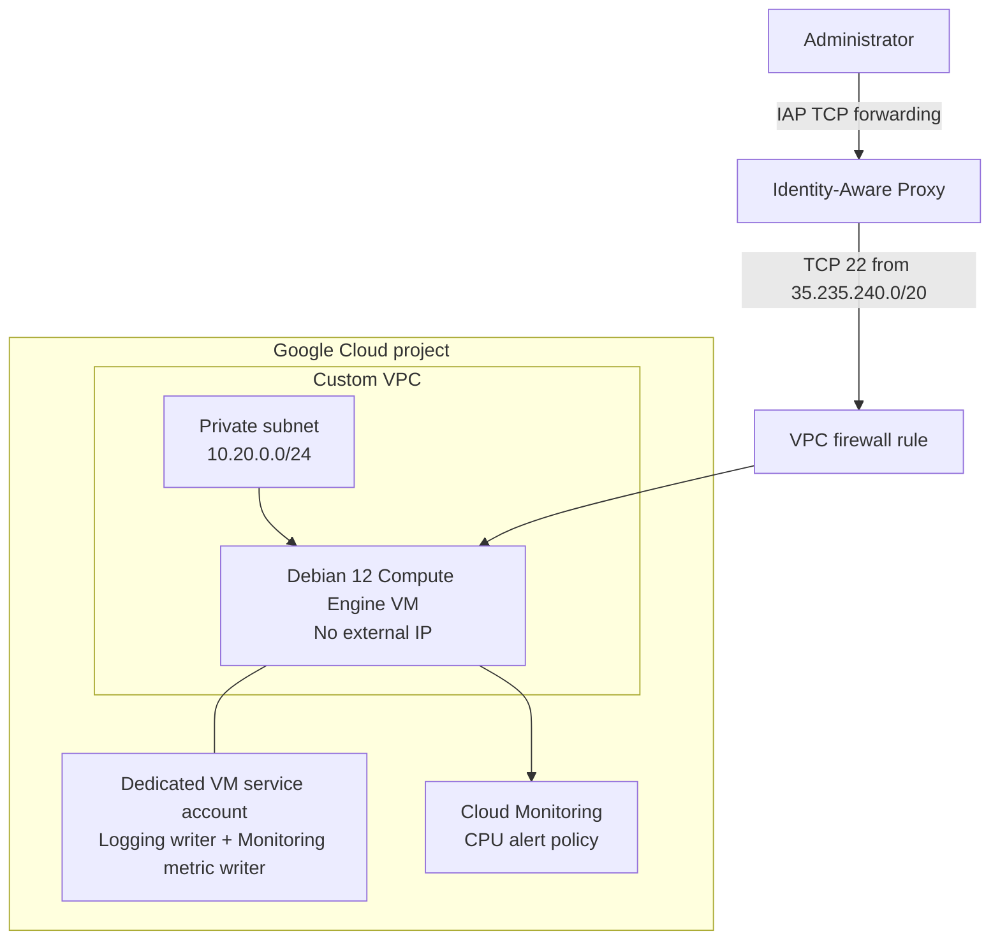

# GCP Secure Infrastructure

**Status: Terraform configuration prepared; not deployed to a live Google Cloud project.**

A hands-on portfolio project for learning how to build a small, security-focused Google Cloud environment with Terraform.

## Goals

- Create a custom-mode VPC and a dedicated subnet.
- Keep the Compute Engine VM private (no external IP address).
- Allow administrative SSH access only through Identity-Aware Proxy (IAP).
- Use OS Login and block project-wide SSH keys.
- Apply Shielded VM protections.
- Give the VM service account only the permissions needed for Cloud Logging and Cloud Monitoring.
- Create a basic CPU utilization alert policy.
- Keep optional logging features disabled by default to help control lab costs.

## Architecture



The VM has no public IP. The firewall permits TCP/22 only from the IAP TCP-forwarding range and only for instances carrying the `iap-ssh` network tag. No application ports are opened.

## Repository layout

```text
gcp-secure-infrastructure/
├── README.md
├── versions.tf
├── variables.tf
├── main.tf
├── outputs.tf
├── terraform.tfvars.example
└── .gitignore
```

## Prerequisites

1. A Google Cloud project with billing enabled.
2. Terraform CLI 1.5.0 or newer.
3. Google Cloud CLI (`gcloud`).
4. An identity with permission to enable APIs and create the resources and project IAM bindings in this lab.
5. IAP TCP forwarding and OS Login permissions for the human administrator who will connect to the VM.

Authenticate locally:

```bash
gcloud auth application-default login
gcloud config set project YOUR_PROJECT_ID
```

Copy the example variables file and set your actual project ID:

```bash
cp terraform.tfvars.example terraform.tfvars
```

Edit `terraform.tfvars`:

```hcl
project_id = "your-real-gcp-project-id"
```

Do not commit `terraform.tfvars`, state files, service-account keys, or other credentials.

## Review and deploy

Run these commands from this directory:

```bash
terraform init
terraform fmt -check -recursive
terraform validate
terraform plan -out=tfplan
```

Read the plan carefully. Only if you understand and approve the resources and possible charges, apply it:

```bash
terraform apply tfplan
```

Terraform enables the required APIs, creates the VPC, subnet, firewall rule, service account, VM, IAM bindings, and CPU alert policy.

## Connect to the VM through IAP

The administrator needs both of these project-level roles (or equivalent custom permissions):

- `roles/iap.tunnelResourceAccessor`
- `roles/compute.osLogin`

If the administrator needs sudo privileges, grant `roles/compute.osAdminLogin` instead of granting broader project permissions.

After the VM is created, connect with:

```bash
gcloud compute ssh secure-admin-vm \\
  --project=YOUR_PROJECT_ID \\
  --zone=us-central1-a \\
  --tunnel-through-iap
```

Use the actual project ID and zone from your `terraform.tfvars` if you changed the defaults.

## Security decisions

- **No external IP:** the VM is not directly reachable from the public internet.
- **IAP-only SSH:** the firewall allows TCP/22 from Google's IAP TCP-forwarding range only.
- **OS Login:** SSH access is managed through IAM-backed OS Login.
- **Project SSH keys blocked:** project-wide metadata SSH keys are not accepted by this VM.
- **Shielded VM:** Secure Boot, vTPM, and integrity monitoring are enabled.
- **Dedicated service account:** the VM receives only `roles/logging.logWriter` and `roles/monitoring.metricWriter`.
- **No secrets in source:** credentials are provided through local authentication and are not stored in Terraform files.
- **Optional logs off by default:** VPC Flow Logs and firewall rule logging can generate additional charges.

## Cost and operational notes

This is a learning environment, not a free or production environment. Compute Engine, persistent disk, monitoring, API usage, and optional logs may incur charges. The default `e2-micro` machine type does not guarantee zero cost; free-tier eligibility depends on Google's current terms, region, usage, and account eligibility.

Before applying:

- Confirm that billing is enabled on the intended project.
- Review current prices for the selected region and machine type.
- Configure a Cloud Billing budget and alerts in the Google Cloud Console. Budget alerts do not automatically stop resources or spending.
- Keep `enable_flow_logs` and `enable_firewall_logging` set to `false` unless you specifically need them.
- Destroy the lab when finished.

The VM has no external IP and this configuration does not create Cloud NAT. It can be administered through IAP, but it will not have general outbound internet access for arbitrary package downloads. Add Cloud NAT only if a later exercise requires it; Cloud NAT has additional charges.

The alert policy monitors VM CPU utilization, but no notification channel is configured. Add an email or other notification channel separately if you want alerts delivered to a person.

## Clean up

When you have finished the lab, review the destroy plan and remove the resources:

```bash
terraform destroy
```

Keep the Terraform source and documentation in GitHub. Do not commit local state files.

## Current implementation status

- [x] Terraform configuration authored.
- [x] Private VPC and subnet defined.
- [x] IAP-only SSH firewall rule defined.
- [x] Shielded Debian VM without external IP defined.
- [x] Dedicated VM service account and limited IAM roles defined.
- [x] CPU alert policy defined.
- [ ] Run Terraform formatting and validation in a local or CI environment.
- [ ] Deploy to a personal GCP project after reviewing costs.
- [ ] Capture evidence and update this README with tested results.

**Portfolio note:** this is a learning project. Do not describe it as deployed or production-tested until you have actually applied, tested, and documented it.
